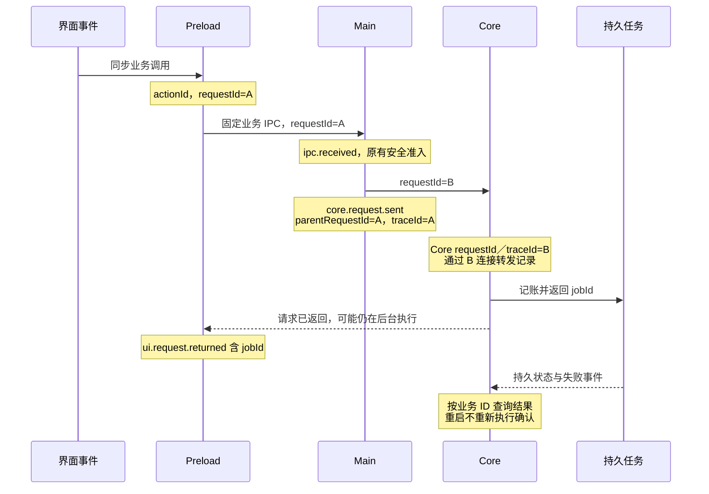

# 桌面日志与请求关联

日志继续由 Main 统一写到 `<隔离 userData>/logs/desktop.log`，使用已有 Pino、结构化转发、大小轮转、队列上限及错误栈脱敏。普通控制台和第三方原始响应不转入统一日志；开发控制会话不需要人工截取日志。

## 身份与因果

统一开发入口注入经过构建核验的 sessionId、runId、buildId，各 Node 进程生成自己的 processGeneration 和单调 sequence。普通启动也由 Main 生成会话身份并传给自有 Core／Sidecar；没有可信构建清单时 buildId 为 `unidentified`，不能宣称当前构建已验收。启动身份只用于诊断，不改变业务授权。

| 字段 | 含义和核对方式 |
| --- | --- |
| sessionId／runId／buildId | 同一隔离会话、本次运行和实际构建；重启使用新 runId，旧日志保留原身份 |
| processGeneration／sequence | 来源进程代际和该进程序号；Main 转发时保留来源值，不用接收时间推断严格先后 |
| actionId | Preload 在真实 DOM 事件分发期间生成；事件结束后的轮询没有此字段，异步调用不能猜测上一点击 |
| requestId／parentRequestId／traceId | Preload 请求 ID、Main→Core 新请求的父 ID和根关联 ID；所有传播 ID 严格核验，不接收 Renderer 指定的宿主会话或构建身份 |
| jobId／operationId／taskId／attemptId | 持久业务对象或一次尝试；重启后按业务 ID 连接前后事件，不能继续使用旧进程请求作为控制句柄 |

Main 的请求上下文使用 AsyncLocalStorage 隔离并发；Core 在请求执行作用域补充业务 logger 的 requestId。取消等待不会终止仍在执行的任务或清除其因果信息。Main 转发不扩展业务协议，也不引入任意诊断或 SQL 调用接口。

## 关键事件目录与完成依据

| 阶段 | 实际事件或受限查询 | 结果解释 |
| --- | --- | --- |
| 宿主与组件启动 | `app.start`／`app.stopped`、`core.start`／`core.ready`／`core.exit`／`core.stopped`、`renderer.ready`／`renderer.exit` | ready 仅证明对应组件就绪；exit 必须同时核对代际和退出原因 |
| 界面及 IPC | `ui.request.started`／`returned`／`failed`／`interrupted`、`ipc.received`／`returned`／`rejected`／`failed` | 输入不进日志；发送和请求返回不等于后台任务完成 |
| Core 受理与返回 | `core.request.sent`／`returned`／`failed`、`core.command.started`／`returned`／`failed` | 请求 ID 连成父子链；返回只提取受限业务 ID，不记录完整结果 |
| 目录授权与恢复 | `configuration.authorize` 请求事件、`directory.restore.failed`、`configuration.directories` 查询 | 授权结果及 available 状态是事实；错误含原目录身份，不能自动换成同路径新目录 |
| 同步预览和确认 | `sync.preview.started`／`finished`／`failed`、`sync.confirmed`、`sync.local.preview.ready` | 确认事件含 previewId、sourceId、jobId；需继续查询 job 状态 |
| 本地复制及记账 | `sync.local.copy.started`／`completed`／`failed`／`interrupted`、`sync.job.state`／`failed` | 物理操作按 operationId／attemptId，业务需求按 jobId；仅 completed 表示该物理操作已提交并记账 |
| 云端传输与恢复 | `download.job.confirmed`／`controlled`／`state`、`download.item.started`／`verifying`／`failed`／`uncertain`、`download.recovery.*` | verifying／uncertain 不算完成；重启按 itemId 和原 attemptId 核对，不重放确认 |
| 识别与整理 | `recognition.task.created`／`started`／`matched`／`failed`、`recognition.organize.failed`、`recognition.mapping.resolved` | matched 不等于整理交付完成；继续查 task、媒体和交付状态 |
| 修正、Emby、清理 | 对应 `corrections.*`、`emby.*`、`cleanup.*` 的 Core 请求事件及现有持久任务查询 | 请求异常通过因果链定位；后台失败以持久任务的 failure／state 为准，未输出事件不代表成功 |

`returned` 记录的 entityId 是结果根对象的 ID，不推断其业务类型；需要结合 action 确认。批量业务以现有逐项明细和持久状态为准，不打印完整请求、模型响应或逐字节进度。转发白名单必须显式登记新增字段；关联 UUID 和进程序号额外校验，伪造值、未登记字段和敏感数据不通过转发进入证据。

## 验证与限制

单元及组件回归覆盖并发上下文、停止等待后继续执行、白名单、脱敏、轮转、队列上限和不可写目录；桌面 `log-correlation.spec.ts` 覆盖 UI 确认、持久同步失败和 Core 重启后续查，`logging.spec.ts` 与 `source-maps.spec.ts` 核对真实转发和源码位置。目录选择在该日志用例使用后台固定替身，不能算原生面板验收。

完整性受日志级别、轮转、转发限流、磁盘队列及崩溃影响。开发控制会话显式使用 debug 级别；普通发行默认 info 时不保证每条请求边均保留。没有错误日志不能作为成功断言。日志查询的游标与完整性报告由任务 2.6 接入；原始 CDP 探索工具的范围另见[页面日志读取](./desktop-cdp-logs.md)。
