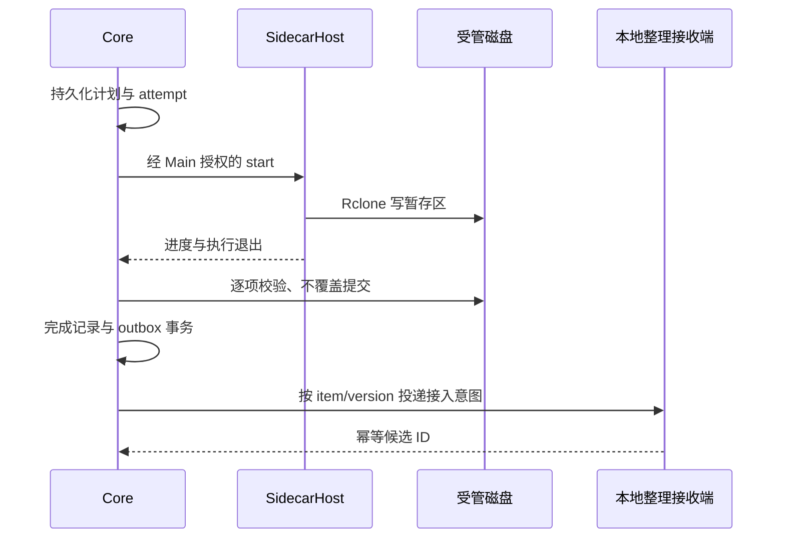

# 内置 OpenList / Rclone 与可替换网盘适配层

## 背景

推荐采用 **OpenList 提供网盘访问、Rclone CLI 执行传输、应用持有业务状态** 的结构。替换 OpenList 时保留账号、订阅、下载记录、界面和媒体整理，仅替换接入实现及其传输源。动机和范围见 [proposal.md](proposal.md)。

### 方案建立时的仓库基线

| 位置 | 当前事实 | 本方案如何接入 |
| --- | --- | --- |
| `apps/desktop/package.json` | Electron 44.9.0、React 19.3.1、electron-vite、electron-builder | 延续现有技术栈和版本锁定 |
| `src/main/core-supervisor.ts`、`src/worker/index.ts` | Main 通过 MessagePort 管理媒体 Utility Process | 增加内部宿主动作与代际隔离，不把远程服务直接交给 Renderer |
| `packages/media-core/src/infrastructure/database.ts` | Core 独占 SQLite，原 v1 已追加云端 v2，保留升级备份与旧本地数据 | Main 和 Sidecar 均不打开业务库 |
| `packages/contracts/src/index.ts` | 已有动作白名单、协议版本、Zod 校验；来源是本机目录 | 新增云端 DTO 与内部协议，保留现有本地来源含义 |
| `src/main/credentials.ts` | safeStorage 保存 TMDB/Emby 凭据，尚无完整云端凭据注入链路 | 扩展账号级引用、读取注入、轮换与删除 |
| `CoreService.getRuntime()` | `manual-only`、parser 为 `unavailable` | 下载独立交付；完整自动整理/Emby 闭环依赖前案后续任务 |
| `electron-builder.yml` | DMG arm64/x64、NSIS x64，尚无这两个二进制资源 | 增加按目标平台筛选的 extraResources 和完整性检查 |

工作区已有桌面迁移内容。当前实施证据与任务状态见 tasks；M0 工具独立于产品功能，不能据此标记后续宿主或下载业务完成。

### 与在途规划的关系

本变更建立在 `add-local-desktop-emby-ingestion` 之上，明确扩展其一期范围。旧文档中的排除项是此前范围决策，不是已经验证的技术限制。

| 前案条目 | 本次后的适用范围 |
| --- | --- |
| `local-folder-ingestion`：本地网盘标签不代表云端授权、不读登录信息 | 继续约束普通本地目录来源；受管云端来源使用本变更新能力 |
| `desktop-runtime`：不启动 HTTP/WS 业务服务 | 媒体业务仍走 IPC；允许受管网盘 Sidecar 的回环 HTTP，不增加 Spring/FastAPI 服务 |
| `desktop-distribution`：网盘客户端由用户另装 | 本地目录方式仍可使用官方客户端；内置夸克下载无需另装客户端 |
| 发行说明不承诺云端订阅 | 云端订阅通过本变更验收后才发布，仍不承诺下载加速 |
| 原前案凭据保护 | 应用权威凭据保持加密；组件运行所需的私有明文副本采用本文的显式例外 |

实施开始时协调对应前案段落和任务文案；若前案已归档，则对这些主规格生成完整 MODIFIED 增量。合并或归档本变更前完成这一检查，不在当前空主规格中伪造已有能力。

## 目标与边界

技术目标是让控制面与传输面均可替换，并使恢复正确性不依赖进程仍存活。用户流程为：配置账号 → 浏览选择 → 预览下载范围 → 下载/订阅 → 完成目录 → 可选整理与 Emby 入库。

首版按普通夸克 Cookie 驱动设计，界面支持一个账号的完整流程，数据和并发隔离按多账号设计。不实现分享转存、远端写入、双向同步、镜像删除、FUSE 挂载、自动扫码登录、自研夸克网络协议或插件安装系统。目标落盘范围沿用当前本机及已验证直连磁盘；NAS/SMB、Linux 与 Windows arm64 不纳入首版兼容承诺。

### 平台范围与推进顺序（2026-10-24 调整）

当前产品只交付一个 macOS 客户端，不拆分平台产品或维护业务分叉。Apple Silicon 为日常开发、真实账号与功能闭环的优先环境；Intel 复用同一客户端，通过相应构建和安装态验证后提供 Mac x64 包。macOS 14 仍为待实测确认的支持基线，不以 macOS 15 CI 结果代替最低系统验收。

| 范围 | 当前工作 | 交付门槛 |
| --- | --- | --- |
| macOS arm64 | 优先完成账号、浏览、下载、提交、队列及恢复的完整用户流程 | 真实账号、真实文件、窗口、故障和 Mac 安装态验收 |
| macOS x64 | 同一产品的架构适配、原生依赖、资源与安装包验证 | 只为实际通过验收的架构提供下载包，不复制业务实现 |
| Windows x64 | 保留现有资源锁、Job Object/ACL 等实现及兼容测试 | 不阻塞当前 Mac 开发或内测；正式启用另立平台交付变更 |
| Linux、Windows arm64 等 | 共享契约允许新增宿主策略 | 当前不开发客户端、不承诺已支持 |

扩展性通过宿主策略和行为契约维持：二进制/架构解析、系统凭据保护、原生进程身份与回收、卷/路径规则、桌面权限和对话框各自封装平台差异。Core、Renderer 与公开 DTO 不携带 macOS 专有命令、进程控制或路径假设；新增平台不应改写下载状态机、业务表或 Provider/Engine 接口。保留现有 Windows 实现，不要求为未交付平台预建整套界面和发行流水线。

后续优先完成 Mac 一次性下载闭环和内测包，再推进订阅及整理交接。第二 Provider 的传输契约测试随 Engine 接通，不能以平台收敛为由削弱替换 OpenList 的边界。已有三目标验证保留原始平台及版本口径，不是后续新增功能的三平台同步交付门槛。

## 设计决策

### 1. 进程所有权与模块落位

Main 是唯一桌面宿主控制入口，管理凭据和组件生命周期。新增一个轻量 `SidecarHost` Utility Process，持有 Provider/Engine、HTTP 连接与日志流，通过独立 Guardian 持有 OpenList/Rclone 的 OS 子进程句柄。Host 不打开业务 SQLite、不决定调度、不持有业务真相；它执行受限基础设施动作，配合 Guardian 在父通道断开后回收 Go 子进程。生命周期保证不能仅依赖 Electron 的正常退出钩子。

M0 实测修正：Main 被强杀时 Utility Host 也可能被 Electron 立即终止，单靠 Host 的父通道回调不足以回收 Go 进程。进程执行层必须增加应用自有的独立原生 Guardian：Host 通过保持打开的 stdin 管道管理它，管道 EOF 触发回收；Windows 在启动子进程前先将 Guardian 自身放入带 KILL_ON_JOB_CLOSE 的 Job，所有子进程继承归属。Guardian 不持有账号业务状态。Main 另保留从自有子进程事件取得、经过父子关系/创建时间/唯一配置路径核对的进程身份，用于 Host/Guardian 故障时清理。M0 原型位于 `tools/desktop-sidecars/guardian/`，正式宿主接线和资源分发仍由后续任务完成。

Core 负责扫描计划、队列、状态机、文件核对/提交及交接。Core 发出内部宿主请求，经 Main 校验并转发给 SidecarHost；结果携带 `coreGeneration`、`attemptId`、序号，经 Main 路由回 Core。长任务返回 ID，不占住现有 15 秒 RPC 等待窗口。Core 退出时 Main 立即撤销其代际并停止对应执行，确认停止后才能授权新核心领取。

各进程继续使用独立的 `@yeatz/app-framework` Application 与静态模块；内部反向 RPC 使用专有白名单，不向 Preload 暴露。

| 拟新增位置 | 职责 |
| --- | --- |
| `packages/contracts/src/cloud/` | 账号/节点/作业 DTO、业务动作及错误；不包含凭据和临时 URL |
| `packages/contracts/src/internal/` | Main↔Core↔Host 内部消息、传输结果；禁止 Renderer 导入 |
| `packages/media-core/src/cloud/` | 订阅、扫描、增量计划、队列、下载仓储、提交和交接 |
| `apps/desktop/src/main/cloud/` | 凭据保险箱、宿主代理、进程代际、原生目录授权 |
| `apps/desktop/src/sidecar-host/` | Provider 注册、OpenList 客户端、Rclone 引擎、进程监管 |
| `apps/desktop/src/renderer/src/pages/` | 云端账号、远端浏览、订阅和下载任务；沿用框架 ViewModel |
| `tools/desktop-sidecars/` | 构建期下载、校验、版本清单和许可材料 |

以下 LikeC4 模型表示目标结构，尚不代表已实现；本段是这份方案的架构模型，不另维护同义 Mermaid 架构图。

```likec4
specification {
  element system
  element component
}
model {
  desktop = system 'Media Marshal 桌面应用' {
    ui = component 'React 与隔离 Preload'
    main = component 'Electron Main：授权与生命周期'
    core = component '媒体 Core：SQLite、计划、恢复与提交'
    host = component 'SidecarHost：Provider 与 TransferEngine'
    guardian = component 'Guardian：父管道与平台进程归属'
    openlist = component 'OpenList：网盘访问与只读 WebDAV'
    rclone = component 'Rclone CLI：批次传输'
  }
  quark = system '夸克网盘'
  disk = system '本机受管下载目录'
  library = system '媒体库与 Emby'
  desktop.ui -> desktop.main '受限业务 IPC'
  desktop.main -> desktop.core '业务命令与状态'
  desktop.core -> desktop.main '内部基础设施请求'
  desktop.main -> desktop.host '授权执行与停止'
  desktop.host -> desktop.openlist '管理 API 与就绪检查'
  desktop.host -> desktop.guardian '受控执行与父管道'
  desktop.guardian -> desktop.openlist '启动与回收'
  desktop.guardian -> desktop.rclone '启动与回收'
  desktop.rclone -> desktop.openlist '只读 WebDAV'
  desktop.openlist -> quark '认证、列目录与代理读取'
  desktop.rclone -> disk '写暂存区'
  desktop.core -> disk '校验与不覆盖提交'
  desktop.core -> library '沿用整理与交付流程'
}
views {
  view bundledDownloads {
    include *
    include desktop.*
  }
}
```

### 2. 控制面和传输面分开抽象

仅包装 OpenList REST API 不足以解耦：如果任务表保存 WebDAV 路径，或 Rclone 直接读取 OpenList 挂载 ID，后续替换仍需改业务。使用下面三个边界，领域层只保存账号、远端引用和版本证据。

```ts
// 设计草图；所有类型为应用自有类型，具体 Schema 在实施时补齐。
interface CloudDriveProvider {
  readonly implementationId: string;
  capabilities(account: AccountRef): Promise<DriveCapabilities>;
  validateCredential(input: PrivateCredentialInput): Promise<AccountIdentity>;
  list(input: ListInput): Promise<RemotePage>;
  stat(input: RemoteRef): Promise<RemoteEntry>;
  acquireSource(input: SourceRequest): Promise<TransferSourceLease>;
  releaseSource(leaseId: string): Promise<void>;
}

// 只存在于 SidecarHost 内部；业务库保存 sourceRequest，不保存本对象。
interface TransferSourceLease {
  leaseId: string;
  generation: string;
  kind: "webdav";
  endpoint: string;
  root: string;
  credentialHandle: string;
  expiresAt?: string;
}

interface TransferEngine {
  readonly supportedSourceKinds: readonly string[];
  start(input: PrivateTransferPlan): Promise<ExecutionHandle>;
  stop(handle: ExecutionHandle): Promise<StoppedExecution>;
  events(handle: ExecutionHandle): AsyncIterable<TransferEvent>;
}
```

`TransferSourceLease` 首版只实现 `webdav` 判别分支。未来需要 `http-object` 时扩展内部联合类型和引擎能力，不预先写空实现。Provider 和 Engine 在 Host 内通过能力协商连接；Core 不认识 `dav/`、`quarkdav:`、Rclone flags 或 OpenList storage ID。

关键类型约定：

- `DriveCapabilities`：授权方式、`stable-id | path` 身份等级、可靠版本/hash 可用性、范围读取与可提供的 source kinds。不能因上游支持某功能就默认当前驱动也支持。
- `RemoteEntry`：应用 `remoteRef`、名称、类型、大小、可选时间/摘要/版本及证据等级。上游 ID 只保存在实现绑定中；无稳定 ID 时明确退化为规范路径身份。
- `TransferEvent`：进度、执行退出与可核对文件证据，不直接产生业务 `COMPLETED`。Core 核对后才提交成功。
- 统一错误：`AUTH_REQUIRED`、`RATE_LIMITED`、`NETWORK_UNAVAILABLE`、`REMOTE_CHANGED`、`REMOTE_NOT_FOUND`、`LOCAL_UNAVAILABLE`、`UNSUPPORTED_CAPABILITY`、`COMPONENT_UNAVAILABLE`、`CONFLICT`、`INTERNAL_ERROR`；可带受限 `retryAfter`，不把上游原始消息直接展示。

Provider/Engine 使用静态注册表和 DI，不允许用户传任意模块路径、二进制路径或 shell 参数。用假的 Provider 与 Engine 运行同一业务测试，并增加一个独立测试 WebDAV Provider，证明下载不依赖 OpenList 特有字段。

### 3. OpenList 仅作为受管网盘网关

新增 `OpenListQuarkProvider`，通过固定版本的公开管理/文件 API 管理账号挂载、列目录和查询元数据；不直接读写 OpenList 数据库。应用生成隐藏的内部挂载命名，与用户可编辑的账号名称无关。OpenList 数据丢失时，以凭据保险箱和实现绑定重建挂载，重新验证远端引用。

重新授权必须核对网盘账号身份；新 Cookie 属于另一个账号时拒绝覆盖原绑定，改走新增账号和范围预览。接入实现无法给出可靠账号身份时，不自动沿用旧目录授权，要求重新选择并核对订阅根。

普通夸克驱动的官方文档要求 Cookie，当前说明采用本地代理；该文档同时提示相关历史逆向接口不主动维护。首版选择普通 Quark 驱动，不把 Quark TV/Open 的授权或 302 行为混用；正式版本必须通过真实账号验证。[OpenList 夸克驱动文档](https://doc.oplist.org/guide/drivers/quark)

初始化顺序：校验包内版本 → 写安全配置 → 启动实例 → 建立私有管理授权 → 关闭匿名访问 → 创建仅 WebDAV 读取权限的账号 → 注册挂载 → 验证列表与读取。管理 API 不假定跨版本稳定，路径、字段与初始化 CLI 用锁定 tag 的源码/API 契约固定，失败即停止启用。

配置显式设置 `scheme.address=127.0.0.1`，不要沿用上游默认监听全部地址。使用应用分配的高位端口；探测空闲端口与实际绑定间存在竞争，应在绑定失败后有限重选，并通过自有进程状态及私有授权核验实例，不能连接未知的现存 5244 服务。[OpenList 配置](https://doc.oplist.org/configuration/configuration)

首个启用的云端账号触发启动，之后在应用后台期间常驻。没有云端账号时不启动；云端故障不阻塞本地来源。OpenList 的 WebDAV 授权只开放读取；其读取与管理权限可分开配置。[OpenList WebDAV 权限](https://openlistteam.github.io/docs/guide/webdav.html)

### 4. Rclone 按批次执行，先不用 rcd

每个活跃传输批次一个 CLI 进程；同一账号首版只运行一个批次，批次内部初始 `--transfers 2`、`--checkers 2`、`--multi-thread-streams 1`。这些是保守默认值，需以真实账号限流和设备数据调整，不是性能保证。多个订阅共享账号预算，禁止并发相乘。

Core 枚举后生成有界、不可变文件清单；同根、同凭据、同目标隔离区的文件组成批次。逻辑上的一次下载作业可以包含多个批次，避免百万文件单进程和整棵目录重新扫描。源路径映射和文件列表由 Host 生成，禁止把远端名称解释成参数或 glob；换行等无法由锁定版本清单接口无损表示的名称使用单文件安全路径或明确拒绝该项。

传输采用 `copy` 加精确清单，单文件可使用 `copyto`；只写新的 attempt 暂存目录。应用先完成增量决策，不将整棵目录 `copy --size-only` 作为调度器。`copy` 不同步删除目标，但可能覆盖目标中的不同文件，因此不能直接面向最终目录运行。[Rclone copy](https://rclone.org/commands/rclone_copy/)

启用 JSON 日志、1 秒统计和匹配的日志等级；逐行解析采用最大行长、有界缓存和未知字段容忍，输出归一化到约 1 Hz。日志夹具必须来自锁定版本。进度只是观测，退出码和逐项文件核对决定结果；重试字节分 attempt 统计，最终成功进度只累计已核对内容。CLI 自身短暂重试与应用退避共用总预算，不能两层无限重试。[Rclone 日志与统计参数](https://rclone.org/docs/)

暂停实现为终止当前进程并等待退出，再标记 `PAUSED`。恢复跳过已提交项，对未完成文件创建新 attempt；首版不承诺字节级断点续传，范围请求能力也不等于跨进程续传能力。取消只撤销剩余执行，不删除已提交文件。

当 CLI 的结构化状态确实不足时，增加 `RcloneRcEngine` 实现相同接口；届时内部 RC job ID 仍不进入领域标识。RC 已提供异步作业、停止和统计接口，但扩大了本地控制面，首版没有必要新增常驻 5572 端口。[Rclone RC](https://rclone.org/rc/)

### 5. 应用拥有增量状态与调度

业务 SQLite 增量迁移，默认原有本地来源不变，不迁移或导入 OpenList 数据库。

| 表/记录（拟） | 关键内容 |
| --- | --- |
| `cloud_account` | 应用 UUID、provider kind、状态、credentialRef；无明文凭据 |
| `provider_binding` | accountId、implementationId、配置版本、generation、非敏感私有映射 |
| `cloud_subscription` | accountId、remoteRootRef、落盘授权、过滤规则、周期、启用、配置版本 |
| `cloud_scan` | 扫描代次、游标、完整性与时间；分页失败不生成删除结论 |
| `remote_entry` | 应用引用、实现映射、路径、元数据、版本证据与最后观察代次 |
| `download_job/item` | 范围快照、条目版本、目标槽位、状态、幂等键及结果指纹 |
| `download_attempt` | item/批次、核心及绑定代际、执行 token、临时路径、重试、退出证据 |
| `ingestion_outbox` | 已提交 item/version → 本地候选；唯一键、投递状态和确认记录 |

以“账号 + 远端引用 + 版本证据 + 目标槽位”归一化同内容请求，用唯一约束或关联表使重叠订阅复用同一下载项；同目标槽位仅一个活跃写入者。订阅配置变更递增版本，未执行计划重新预览，活动 attempt 使用不可变快照。扫描期间 root 不可达、分页失败和目录改名都不表示删除。

共享下载项保留各作业/订阅的需求关联。取消单个作业仅解除其需求，仍有其他有效需求时继续传输；账号级暂停才停止整个账号。最后一个需求取消后才终止共享执行并按规则清理暂存区。

版本比较优先级：可靠 provider revision/hash → 经验证的源元数据组合 → 路径与尺寸弱比较。mtime、ETag 不因字段存在就视为内容版本。普通 WebDAV 不提供可依赖的通用摘要/修改时间能力，因此 OpenList 管理 API 的源元数据与传输接口能力分别记录；实际拿不到可靠证据时，在 UI 明示弱比较。[Rclone WebDAV 能力](https://rclone.org/webdav/)

同版本且本地已提交文件符合本地指纹才跳过。已知远端变化创建新候选，目标有同名旧成果则默认冲突待确认；不覆盖旧下载、不自动替换已整理媒体。弱比较无法发现同尺寸原地替换，提供“强制重新下载”并形成新请求，不把本地 SHA-256 当作远端内容正确性的证明。

订阅默认周期建议 15 分钟，可配置；账号级抖动、退避和限流优先于该周期。应用退出期间不运行订阅；启动/唤醒后合并漏过触发为一轮补扫。用户显式启用自动下载后才持续运行。

### 6. 暂存、提交与媒体整理交接

用户选择受管下载根，应用建立 `.media-marshal/staging/<attemptId>/` 与 `completed/`，两者在同一已验证卷上。目标根需要原生目录授权、realpath/卷身份和可写校验；缺盘不自动创建同名替代目录。该根与其他来源/媒体目标不得交叉覆盖。所有普通扫描入口排除 staging；受管 completed 由专有来源登记，补扫通过同一 item/version 去重入口。

落盘映射公共层检查 `..`、绝对路径、分隔符、越界与目标占用；目标平台策略处理卷身份、命名、Unicode、大小写与路径长度。Mac 首先实测 APFS 的大小写及 Unicode 行为；Windows 盘符、保留名和重解析点策略保留为后续平台适配与兼容用例，不在 Mac 上无条件套用 Windows 命名限制。映射结果持久化；遇到不支持名称或碰撞明确失败，不静默映射到同一目标。写入与提交前再次核对真实父目录，防止链接逃逸。

Core 对已结束执行逐项检查：文件是正式暂存结果、长度正确、可用远端版本未变化、有上游摘要则匹配摘要。生成本地摘要用于后续恢复和本地改动检查；无远端摘要时完整性等级标为“长度/版本核对”，不宣称端到端摘要校验。非零退出批次中的完整项也按相同条件独立核对；证据不足项保留失败。

提交复用前案计划中的“不覆盖文件提交”组件，并把该能力作为共享前置工作：持久化提交意图 → 同卷校验 → 经平台验证的不覆盖提交 → 事务写完成记录及 outbox。`exists` 后 `rename` 不足以保证不覆盖；不支持可靠提交语义的卷直接阻断。崩溃后按计划、摘要和目标归属补记，无法证明的转待处理。预检空间覆盖下载暂存、已完成副本和后续 COPY 媒体副本，额度不足停止新领取。



整理接收端仍执行识别、低置信度确认和媒体 COPY，不因来源为受管下载就跳过媒体规则。前案未完成时 outbox 保持待接入，下载本身可完成；不可使用虚假的 `media_task=DONE` 补齐界面。后续自动整理与 Emby 成功分别由原链路记账。

### 7. 状态机、恢复与用户操作

下载项主路径为 `QUEUED → RUNNING → VERIFYING → COMMITTING → COMPLETED`。执行侧分支为 `PAUSING → PAUSED`、`CANCELLING → CANCELLED`、`RETRY_WAIT`、`AUTH_REQUIRED`、`FAILED`；缺盘记为 `BLOCKED_LOCAL`，恢复核对记为 `RECONCILING`。作业状态从成员聚合，扫描中不显示虚构总量。

- 暂停/取消在 `COMMITTING` 期间等待单项安全提交完成，然后停止剩余项；已完成文件始终保留。
- 账号认证失败停止自动重试并请求重新授权；限流停止账号所有新领取，按 Retry-After 或有界退避恢复。
- OpenList 崩溃使租约失效，终止相关 CLI 并有限恢复；进程恢复不能直接复用旧临时 URL 或旧代际请求。
- Main 显式退出：Core 停止领取 → Host 停止 CLI → Core 核对并落盘 → Host 停止 OpenList → Core 关闭 SQLite。
- Main 崩溃：Host 通过专用父通道关闭/心跳到期请求停止；即使 Host 同时被终止，Guardian 仍通过父管道 EOF 回收自有 Go 进程。Core 通过父通道关闭停止。Host/Guardian 崩溃而 Main 存活时，Main 根据已登记的自有句柄/执行身份回收残留进程，再允许重建。进程查询失败不能作为已停止的证据。
- macOS 使用受管进程组及父通道监管，其强杀与旧写入者回收是当前 Mac 验收门槛。Windows Job Object 及已有用例作为保留的兼容实现，后续 Windows 启用前再做完整验收。PID 文件不能证明归属，禁止按进程名批量杀进程；任何平台没有确认旧写入者退出时，都不得启动新 attempt。

窗口关闭仍后台执行，托盘分别提供“暂停云端下载”和既有“暂停接入”，不混淆传输与整理。账号页显示凭据状态；目录页支持选择与预览；下载页展示阶段、速度、剩余量可用性和失败原因；订阅页显示最近扫描、下次执行、弱比较说明与启用开关。

### 8. 凭据与本地 API

权威 Cookie、管理凭据保存在 Main safeStorage 保险箱，Core 只保存引用。用户粘贴 Cookie 时 Renderer 仅短暂持有输入草稿，提交后清空；读取 API 永不回显。Main 解密后通过受限私有通道注入 Host，不经命令行、日志或事件进入 Renderer。

OpenList 可能将驱动 Cookie 写进自己的数据库；safeStorage 不会自动加密该副本。首版显式允许其运行私有数据目录持有该副本，macOS 目录 0700/文件 0600，Windows 使用当前用户 ACL，普通业务备份及诊断一律排除。解除账号连接时先终止租约、删除挂载并清除保险箱；SQLite/WAL 或磁盘残留不承诺安全擦除。实现前须验证锁定版本的凭据写入位置并在隐私说明中披露。

Rclone 临时配置只包含该批次 WebDAV 只读授权，不包含夸克 Cookie。使用每次执行的受限目录和最小环境，退出后清理，启动时清理已确认无主的旧配置；`obscure` 只是可逆混淆，不能当作加密。命令行只含受控配置文件路径，诊断不收集配置内容。

关闭 OpenList 匿名读取与无关服务，管理账号与 WebDAV 读取账号分开；不将管理后台嵌入应用、不在 Renderer CSP 允许本地服务访问。Host 仅访问清单中登记的回环服务；本地外部页面通过 API 无法取得授权。同一 OS 用户的恶意进程不在“靠 loopback 即可隔离”的保证范围内。

### 9. 打包、升级与来源追踪

当前构建及分发以 `darwin-arm64`、`darwin-x64` 为目标，下载明确 release 资产并验证预先锁定的 SHA-256；登记版本、tag/commit、上游地址、许可证、构建来源与目标架构。已有 `win32-x64` 锁定资产及准备能力保留，不随 Mac 包分发，也不要求同步生成 Windows 安装器。只打入当前目标的可执行文件和必要许可证，不把整个下载缓存递归复制进包。签名改变文件摘要时区分上游原始摘要和最终签名产物摘要，最终资源清单在签名流程中正确生成。

```text
Resources/
  app.asar
  bin/openlist[.exe]
  bin/rclone[.exe]
  bin/guardian[.exe]
  sidecars/manifest.json
  sidecars/licenses/...
userData/
  desktop.sqlite3
  credentials.enc.json
  sidecars/openlist/...
  runtime/rclone/<attemptId>/...
```

`electron-builder extraResources` 将二进制放在 ASAR 外。开发态和安装态统一通过 `SidecarBinaryResolver` 定位：开发指向目标平台准备目录，安装态指向 `process.resourcesPath/bin`；不依赖 cwd，避免示例中开发路径多拼一层 `bin` 的问题。[electron-builder 资源配置](https://www.electron.build/docs/contents/)

沿用手动整包升级，不执行 `rclone selfupdate` 或 OpenList 自更新。停止组件后备份其私有库、核心库及绑定版本，迁移成功才重新启用。私有备份与普通导出分开管理并使用相同权限；回退必须恢复匹配的数据快照，不能让旧组件打开新库。媒体文件不随数据库回退删除，恢复后重新核对。

Mac 内测包可在明确标识未签名状态、完成安装态与功能验收后用于开发验证；这不等于正式公开发行。公开 Mac 包仍须 Developer ID 签名、公证和嵌套二进制验证。用户当前没有签名配置，正式发行任务保持未完成；Windows 签名/安装器不再是本轮 Mac 交付前置。

OpenList 当前许可证为 AGPL-3.0，Rclone 为 MIT；仓库现有桌面包声明 GPL-3.0。发行清单需保留许可及版权、固定版本对应源码与构建/修改材料，并评估组合分发义务。独立进程有助于技术隔离，不能自动得出闭源豁免结论；本提案不改变仓库许可证。[OpenList LICENSE](https://github.com/OpenListTeam/OpenList/blob/main/LICENSE)、[Rclone Licence](https://rclone.org/licence/)

### 10. 替换 OpenList 的明确路径

推荐未来先实现 `NativeQuarkProvider + 只读 WebDAV Bridge`，继续复用 `RcloneCliEngine`。Bridge 只实现经过 Rclone 兼容验证的 OPTIONS/PROPFIND/HEAD/GET、长度/路径编码/范围读取、授权及错误映射，不复制 OpenList 的管理后台、用户体系和通用存储驱动。

若自研适配器能够提供可靠的逐文件 URL、请求头和刷新机制，再实现 `http-object` 租约及相应 Engine。URL 的有效期、Cookie/Referer、Range 和过期刷新必须由基础设施解决，不把签名直链存入任务表。这样可以去掉 WebDAV Bridge，但比保留 WebDAV 更需要传输兼容验证，首版不预付这部分实现成本。

账号级切换流程：

1. 注册候选实现但不切流；用同一契约测试验证目录、错误和租约语义。
2. 用户触发账号迁移，暂停该账号领取，等待旧 attempt 停止并回收租约。
3. 候选实现验证授权与账号身份；对稳定原生 ID 做映射，路径/弱证据无法证明一致时要求重选订阅根并预览。
4. 事务切换 binding 与 generation，保留旧绑定和本地历史；重扫并按新证据生成计划，不复制旧执行 token。
5. 观察失败率、重试、内存、吞吐和授权成功率后扩大使用；失败可按相同静止流程切回旧绑定，保留所有已提交成果。

完成替换的验收标准是：下载业务模块和 Renderer 不需要导入新 Provider 类型；现有订阅与本地成果保留；核心业务测试不变；Provider/Engine 契约测试通过。移除最后一个 OpenList 绑定且回退窗口结束后，才在后续版本考虑移除其二进制。

## 风险与取舍

| 风险/代价 | 应对与验收依据 |
| --- | --- |
| 夸克驱动与上游授权行为变化 | 固定具体驱动/版本；真实账号验证成功才启用；认证故障阻断并保留本地目录接入 |
| WebDAV/源元数据版本证据不足 | 显示弱比较；新版本冲突待确认；提供强制重新下载，不承诺发现所有同尺寸变化 |
| 额外 Host 与代理转发增加开销 | 按账号启用、流式传输、有界日志；测量全进程 CPU/内存/安装体积，暂无性能收益结论 |
| 双份下载与媒体 COPY 占磁盘 | 下载/整理前空间预算，暂存回收只处理自有文件；不通过自动删除来源节省空间 |
| OpenList 私有库含敏感信息 | 明确明文副本边界、用户权限、导出排除、解除连接及备份策略 |
| 平台进程树清理与不覆盖提交难实现 | 当前优先在 Mac 故障注入；Windows 保留兼容实现，未来启用前独立验收；未通过的平台或卷不宣称支持 |
| 前案核心流水线尚未完成 | 下载里程碑独立；自动入库里程碑依赖共享提交、整理接收端与 Emby 能力 |
| AGPL 及组件分发义务 | 发布材料按锁定版本核对；不把进程隔离当作许可证结论 |

## 实施与迁移计划

1. **M0：可行性验证。** 锁定一个 OpenList/Rclone 组合，验证 Cookie 授权、只读列表、代理下载、大文件、Range、进度、凭据落盘和进程清理。已有三目标结果保留为历史证据；后续以 Mac 为当前验收范围。
2. **M1：边界与持久化。** 扩展契约、内部宿主通道、SidecarHost、账号保险箱和业务迁移，用假实现跑通计划与状态机。静态假实现不需要真实账号。
3. **M2：Mac 一次性下载与内测包，当前优先。** 接通账号配置、浏览、范围预览、真实 Provider/Engine、完整文件下载、校验提交、暂停/取消/恢复与真实窗口；完成目录独立可用。同步准备 Mac 资源及安装态验证，通过第二 Provider 测试确认传输边界；不等待 Windows 或前案 Emby 闭环。
4. **M3：Mac 持续订阅。** 实现完整分页、首次预览、定时/手动合并、增量证据、限流、缺盘和休眠恢复。
5. **M4：Mac 整理闭环与发行准备。** 对接前案本地候选/整理/Emby，完成 outbox 幂等、绑定迁移回退及 Mac 升级/安装验收。正式公开发行单独满足 Mac 签名/公证门槛；其他平台客户端不在本变更交付范围。

业务 schema 使用追加迁移；旧 `desktop_source` 不被隐式改成云账号。新功能默认未配置、未启用，不在升级时扫描网盘。回退版本如不支持新 schema，使用匹配备份并核对磁盘，不能覆盖现存媒体。

具体任务及验证命令见 [tasks.md](tasks.md)。M0 已锁定 OpenList v4.2.7 lite 与 Rclone v1.75.2，执行真实账号的只读列表、指定大文件前 8 MiB 代理读取、Range 与失效 Cookie 验证；脱敏证据位于 `tools/desktop-sidecars/`。这些结果不证明整文件传输性能或正式安装包可用，目标平台运行结果单独记账。本段 LikeC4 为设计模型，尚未运行其渲染器验证。
