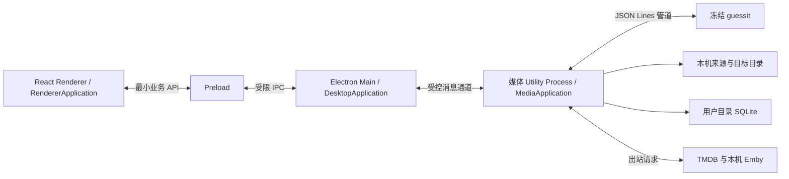

# 独立 Electron 客户端产品与技术设计

## 上下文

动机与范围见[提案](proposal.md)。2026-10-18 确定：一期为 monorepo 下的独立 Electron 客户端，React 重建界面，一期所需 Java 业务能力迁入 TypeScript；采用 `@yeatz/app-framework` 组织模块、服务、状态与生命周期。本变更仍解决本机网盘下载后的电影/剧集入库，产品目标不变；架构不再采用 Electron 启动 Java 服务，也不以同步交付 Web 版为门槛。

Emby 与下载均在用户电脑上，官网提供 macOS/Windows 安装包。夸克、百度和阿里云盘只监听官方客户端下载目录，也支持自定义目录。应用不需要产品账户或用户部署后台；TMDB 与 Emby 的网络依赖仍存在，离线不是所有识别功能可用的承诺。

### 已观察到的项目基线

| 位置 | 现状 | 迁移含义 |
| --- | --- | --- |
| `frontend/` | Vue、Element Plus、Pinia、vue-i18n；相对 HTTP 和 STOMP | React 重建客户端，复用经核对的类型、纯函数、文案与交互语义；旧 Web 保留但不扩建 |
| `backend/src/main/java/com/mediamarshal/service/discovery` | WatchService、增量补扫、临时过滤；入口就绪检查不一致 | 在 TS 中统一事件和扫描入口，新增持久化候选 |
| `service/parser`、`service/matcher` | guessit 结果归一化、查询计划、父目录证据、评分、缓存、季集验证 | 迁移纯业务规则及失败语义，不能只保留简单名称搜索 |
| `service/rename` | 自定义模板语法、路径检查、普通视频及附属文件处理 | 迁移模板行为，强化真实路径和不覆盖提交，首版接入只复制 |
| `service/queue`、`service/correction` | 批量识别、确认、修正指纹和历史；恢复保证不完整 | 迁移核心交互并实现可持久化执行，故障场景优先于逐行翻译 |
| `model/entity`、`repository`、`config/Sqlite*` | JPA/SQLite；`ddl-auto=update` 与显式兼容 Runner 并存 | 新桌面库使用版本化 SQL，不复制 Java ORM 或直接复用旧库 |
| `parser/main.py` | FastAPI 只是 `guessit(filename)` 的薄 HTTP 包装 | 新增只依赖 guessit 的 stdio 入口，冻结为离线工具，不启动 HTTP 服务 |
| `EmbyLibraryRefreshService` | 内存刷新标记，无持久化收录核对 | 迁移 Emby 调用并补独立交付作业 |
| 后端测试与架构文档 | 已有模板、评分、季集、修正和恢复用例 | 作为语言迁移的行为基线，已知缺陷以新规格为准 |
| `LICENSE` | GPL-3.0 | 发行继续携带适用许可和源码获取方式 |

产品调研基线为 2026-10-17，代码与桌面选型于 2026-10-18 复核。官方资料证明支持能力，工程选择与性能假设仍需真实产物验证。个人 `desktop-app-engineering` Skill 作为选型参考，不作为必须安装全部依赖的模板。

表中省略前缀的 Java 模块路径均相对于 `backend/src/main/java/com/mediamarshal/`，对应测试位于 `backend/src/test/java/com/mediamarshal/`。

## 目标与非目标

**目标：** 一个安装包完成运行；React 提供首次配置、来源、任务、待处理与设置；TS 媒体核心负责识别、复制、恢复与 Emby 交付；窗口关闭后可继续工作。通过旧行为夹具与新故障测试保留媒体正确性，避免把服务端代码简单搬进主进程。

**边界：** 一期不交付新 Web、远程 NAS 后台、账号支付、自动更新、网盘云端下载、Codex CLI 桥接或 SMTP；不接入音乐、ISO、蓝光和非复制入库。旧 Java/Vue/Docker 代码保留作参考及既有用户独立部署入口，不作为客户端回退服务或新功能双写目标。桌面数据独立，旧服务端库导入另立变更。

## 决策

### 1. 市场定位：验证网盘下载后的本机入库体验

**判断：存在细分需求，付费规模未验证。** 区分需求证据与商业推断：成熟产品证明整理和自动化有人使用；这些证据不能推导付费人数、获客成本或市场总额。

| 类别 | 一手公开证据 | 对定位的含义 |
| --- | --- | --- |
| Emby 社区整理插件 | [Auto-Organize PLUS 作者](https://emby.media/community/topic/109245-auto-organize-plus-public-beta/)描述多监控目录、版本比较、处理中和待确认状态 | 整理、冲突提示、人工确认已有人提供；新产品须验证更低配置和修复成本 |
| Emby 内置生态同步 | [Folder Sync 官方文档](https://emby.media/support/articles/Folder-Sync.html)描述从库内内容复制或生成多分辨率副本，是 Premiere 功能 | 面向已有内容的备份与转出，不能视为外部资源下载入库 |
| Emby 频道插件 | [Sync Channel 作者](https://emby.media/community/topic/148783-plugin-ginjaninja-tools-sync-channel-radarr-sonarr-any-rest-api-channel-sync-tool/)描述从外部接口生成频道树，作者标记为早期测试 | 主要解决展示和即将上线信息，不能作为可靠下载闭环的证据 |
| 完整自动化 | [Sonarr](https://sonarr.tv/)、[Radarr](https://radarr.video/)、[MoviePilot](https://github.com/jxxghp/MoviePilot) | 强功能替代；Sonarr 已有 Windows 原生安装，桌面形式本身不足以区分 |
| 桌面媒体整理 | [FileBot](https://www.filebot.net/purchase.html)、[tinyMediaManager](https://www.tinymediamanager.org/) | 已有商业授权与桌面整理工具；应比较实际配置、中文识别和修复体验 |
| 新的一体化工具 | [Mediarium 自述](https://mediarium.app/)描述下载、整理和通知媒体服务器的一体化流程，提供 Docker 部署 | 集成多个工具本身也有竞争，介绍中的效果未经本次实测 |

优先用户画像：已有本机 Emby，经常从国内网盘客户端手动选择影视下载，但不愿部署维护完整自动化栈的人。重度追更用户及只想整理一次存量资料的用户属于次级人群。

免费工具交付“少配置、少误整理、出错能修好”的结果；后续官方识别与整理 API 的付费价值是免配置服务和更少的人工识别处理。三种网盘共用本地目录接入实现，来源名称主要帮助首次设置。官网措辞使用“网盘下载目录自动入库”，避免将尚未提供的云端订阅写成卖点。官方入口可参考[夸克](https://pan.quark.cn/)、[百度](https://wangpan.baidu.com/download)、[阿里云盘](https://www.alipan.com/)；本次未取得可用于判断完成状态的官方事件协议，百度下载页面抓取超时，不据此断言其具体版本行为。

### 2. 商业验证先于付费系统

以下是建议的实验门槛，属于团队设定的决策条件，不是市场统计或交付保证。

1. 访谈 10～15 位符合画像的用户，观察其真实目录、命名、下载和入库过程；记录每周频率、耗时和替代工具。
2. 邀请约 20 位用户安装内测，覆盖两种系统及三种网盘来源；至少半数在无实时协助下完成首次入库，再逐项定位失败原因。
3. 以首次入库耗时、首次配置放弃率、一周后仍有使用者占比、人工修复次数为核心指标；未经同意不上传文件名、目录或库清单。
4. 桌面端与便捷、完整的整理核心免费，不测试桌面买断或更新续费。后续通过官方识别与整理 API 的体验额度和按量包验证付费意愿，关注真实付款、识别效果、复购、支持成本和退款原因；价格与额度待实测，不将口头好评视为购买证据。

商业路线分为免费整理工具、官方 API 按需付费、消息通知等会员服务三个阶段，完整边界、运营转化与候选价格见[商业与付费策略](../../../docs/product/business-and-operations.md)。本变更仅交付第一阶段的桌面接入能力，不预建支付、账号、官方 API 或托管通知平台。基础保护、人工纠错和媒体服务器交付保持免费，自备识别服务的接入能力不以购买官方 API 为前提；接口支持范围按实际版本说明。后续官方 API 和会员服务另立变更，继续遵守现有开源许可。

### 3. 信息架构：把问题与下一步放在同一处

| 页面 | 用户要完成的事情 | 主要信息 |
| --- | --- | --- |
| 总览 | 判断自动化是否正常 | 运行状态、来源健康、待处理数量、最近已收录 |
| 任务 | 查看某文件卡在哪一步 | 来源、作品、进度、目标、整理与 Emby 两组状态 |
| 待处理 | 修复需要决策的问题 | 候选确认、季集修正、文件就绪确认、目录冲突和重试 |
| 来源与设置 | 接入目录、连接 Emby、调整运行方式 | 来源标签、真实路径、策略、空间、连接测试、托盘与诊断 |

首次引导顺序：确认本机 Emby 和官方客户端前置条件 → 测试 Emby 连接 → 选择 Emby 库内目标目录 → 选择来源及下载目录 → 配置元数据凭据 → 小范围扫描并预览 → 完成首次复制与收录核对 → 解释就绪判断局限后选择是否自动接入。

内测阶段继续由用户填写自己的 TMDB Key；这是首次使用门槛，须统计该步骤的放弃原因。未来是否提供托管元数据服务属于独立商业决策，不能将产品共用密钥写进安装包。

自动接入默认关闭；来源首次使用先走确认预览。预览列出来源文件、作品年份、季集、目标、预计复制量、可用空间和阻断项，支持小范围确认，不默认对整个历史下载盘执行整理。开启自动后，新文件满足就绪、识别与目标校验才执行。

任务错误统一呈现“发生了什么、文件在哪、接下来做什么”。低置信度去选择候选；权限错误去重新选目录；空间不足去释放空间；Emby 不可达去检查连接；核对超时只重试交付。

### 4. monorepo 与 TypeScript 客户端核心

用户选择 React，原因是界面复杂度可控且维护者熟悉 React；不以框架性能或 AI 生成正确率作未经测量的判断。采用 npm workspaces，沿用 npm 使用习惯，不同时引入 pnpm、Nx 或 Turborepo；若构建规模增长再评估任务缓存。

建议目录为：

```text
apps/desktop/
  src/main/             窗口、托盘、权限、凭据、生命周期
  src/preload/          最小业务 API
  src/renderer/         React 页面、组件、文案
  src/worker/           Utility Process 入口及进程适配
                        各进程在自身 bootstrap 组装 Application/modules
packages/contracts/     Zod schema、DTO、命令与事件契约
packages/media-core/    TS 业务规则、存储与文件/网络适配
  src/domain/           评分、季集、模板、计划等纯逻辑
  src/application/      入库、确认、修正、交付用例
  src/infrastructure/   SQLite、文件系统、TMDB/Emby、parser 管道
  src/modules/          静态 ApplicationModule、服务标识和依赖声明
  migrations/           桌面库有序 SQL 迁移
  tests/fixtures/       脱敏行为及故障夹具
tools/desktop-parser/   guessit stdio 入口、冻结构建与依赖清单
vendor/yeatz-app-framework/  未发布阶段的固定包快照、来源与校验清单
docs/                   现有文档站
backend/ frontend/ parser/  旧实现，保留原位置与构建入口
```

仅 `apps/*`、`packages/*` 进入新工作区；旧前端保留独立锁文件和构建，根文档站脚本保留。桌面发行以正向产物清单排除旧目录。新客户端不依赖旧 Vue 源码或 Java 运行时；需要复用的纯 TS 工具应明确迁入新包并迁移测试，不能靠跨目录引用使旧应用成为隐式依赖。

`contracts` 不依赖 Electron/Node 或应用框架，允许 Renderer 引用；`media-core` 不依赖 React/Electron，领域纯函数不依赖 DI，应用服务及模块层可使用框架核心入口，仅用必要的适配接口隔离存储、文件与网络；`desktop` 负责进程适配与最终组装。首版只有一个 UI 消费方，不先拆通用 `ui` 包，也不为未来 Web 编写 HTTP 适配。依赖方向为 desktop → contracts/media-core，media-core → contracts，禁止循环依赖和 Renderer 导入媒体核心。

| 层次 | 选择 | 原因与约束 |
| --- | --- | --- |
| 桌面运行时 | Electron | 核心迁入 Node/TS 后可以直接承载文件、网络与 npm 依赖，维护者无需同时引入 Rust 宿主 |
| 应用框架 | `@yeatz/app-framework` | 每进程独立 Application、静态 ApplicationModule、DI 与受管生命周期；按公开子路径导入，不代替 Electron 宿主或 IPC |
| 构建/分发 | electron-vite + electron-builder | 编译 Main/Preload/Renderer/worker 并生成 DMG/NSIS；单一发布链路，首版手动升级 |
| 界面 | React + TypeScript strict、shadcn/ui、Tailwind CSS、语义 Token | 项目持有使用的组件源码，围绕入库任务重建；不机械翻译 Element Plus 页面 |
| 路由/文案 | React Router hash 路由；i18next + react-i18next | 本地协议下导航稳定；复用中英文文案并核对插值，中文默认、英文可切换 |
| 状态 | StatefulService、computed、useServiceState；组件临时状态用 React | 框架内部已用 Zustand；应用不再另建全局 store，Renderer ViewModel 只保存核心 DTO 的视图与交互状态 |
| 契约 | TypeScript + Zod | 主进程校验来源及动作，核心再次校验业务约束；类型校验不替代授权 |
| 业务进程 | 单个 Electron Utility Process | 在带 Node 的应用子进程中执行核心，避免同步 SQLite、扫描与计算阻塞 Main |
| 数据 | better-sqlite3、显式 SQL、有序版本迁移 | 一处连接和业务写入所有者，短事务；不增加 ORM、不共享旧 Java 库 |
| 文件系统 | Node fs/streams/crypto；事件监听加周期核对 | 流式复制和摘要，有界并发；监听只是发现提示，补扫与就绪状态才承担正确性 |
| 网络 | 核心内集中 TMDB/Emby 客户端 | 超时、取消、代理、缓存与重试统一；Renderer 不持有服务密钥 |
| 名称解析 | 冻结 guessit 子进程、JSON Lines stdio | 暂保留解析质量，去掉 FastAPI/uvicorn 和监听端口；以后替换解析器需过同一夹具 |
| 测试 | Vitest、现有可迁移纯逻辑用例、Playwright Electron | 纯规则对照与真实文件/SQLite 测试结合，再做真实窗口及安装态验收 |

工作区能力依据 [npm workspaces](https://docs.npmjs.com/cli/v11/using-npm/workspaces/)，业务子进程依据 [Electron utilityProcess](https://www.electronjs.org/docs/latest/api/utility-process)，SQLite 依据 [better-sqlite3](https://github.com/WiseLibs/better-sqlite3)。同步数据库调用应保持短小、分页且可观测；Utility Process 不会自动消除其自身阻塞，长计算仍需分片或经测量后使用 worker，不让多个 worker 同时拥有业务库。

UI 接入依据：[shadcn/Vite](https://ui.shadcn.com/docs/installation/vite)、[Tailwind/Vite](https://tailwindcss.com/docs/installation/using-vite)、[React Router](https://reactrouter.com/start/declarative/installation)、[react-i18next](https://react.i18next.com/latest/using-with-hooks)。具体依赖、Electron 与 Node 组合在实现时锁定。Query、虚拟列表和动效库按实际需要引入，避免把参考栈变成依赖清单。

#### 4.1 应用框架的接入方式与职责

依据为本机 `/Users/zhangyichi/workspaces/wenger-repo/packages/app-framework` 的 `src/application/index.ts`、`src/ioc/`、`src/lifecycle/`、`src/command/commandService.ts`、`src/react/` 及包导出配置。2026-10-18 收尾复核时包名为 `@yeatz/app-framework`、版本为 `0.1.0`，仓库 HEAD 为 `002887f3537db2714e6bd5ea72c2ca9312f81b8e`，框架目录无未提交变更；实际接入时仍需重新记录所用源码与包校验值。框架采用 MIT 许可，继续在第三方说明中保留。

框架提供进程内服务容器、模块拓扑启动/逆序清理、命令注册、EffectScope/ScopedServices 和 React 状态订阅。它不提供 Electron 窗口管理、跨进程代理、数据库、文件事务、任务持久化或进程守护。采用框架后，原有安全及恢复约束仍需实现，不将生命周期自动清理当作崩溃恢复。

| 运行位置 | Application 与建议模块 | 数据和权限边界 |
| --- | --- | --- |
| Main | DesktopApplication：凭据、窗口/托盘、核心进程监管、受限 IPC | 拥有 Electron 原生能力与子进程句柄；不打开业务库 |
| Utility Process | MediaApplication：storage、parser、metadata、recognition、organizer、delivery、ingestion、业务命令入口 | 组装 media-core；独占 SQLite、任务与文件操作 |
| Renderer | RendererApplication：desktop-client、navigation、sources、tasks、review、settings | desktop-client 只包装明确的 Preload 方法；其他模块提供 ViewModel 和页面交互 |
| Preload | 不创建 Application，仅实现最小类型化桥 | 不注入 DI 容器或媒体核心，不传服务实例 |

使用 `@yeatz/app-framework/application`、`/ioc`、`/lifecycle`、`/command` 等公开入口；只有 Renderer 引用 `/react`。不用 `/legacy` 或深层源码导入。所有容器、注册表和服务实例仅属于本进程 Application，不使用全局命令注册表。跨进程只传 contracts 定义的普通数据；DI 标识、AbortSignal、函数和服务对象不经过 IPC。

一期以静态 `ApplicationModule` 为单位，`register` 同步绑定、`start` 获取资源并启动、`stop` 做最终协调。所有模块先完成注册，再按 `dependencies` 顺序启动；注册阶段不解析尚未绑定的服务。Core 的 storage 最先启动并最后释放，parser/metadata 等适配先于依赖它们的用例启动，恢复完成前 ingestion 不启动发现和领取新任务，业务命令就绪后才上报核心可用。各模块声明实际依赖，避免靠数组顺序控制启动或通过跨模块内部字段绕过边界。

服务使用 `createIdentifier` 与显式 `@inject(Token)`；使用装饰器的 TS 编译启用 `experimentalDecorators`，采用框架当前的 legacy 装饰器语义，不依赖隐式参数类型元数据。首次原型同时验证 electron-vite 各入口及测试编译配置，避免开发态通过、打包后注入失败。简单规则仍是纯函数，不为每个模型创建类。资源只登记一个清理所有者：容器管理的 DisposableService、模块 effects 或 disposables 三者择一，避免重复关闭数据库、文件句柄或监听器。

Renderer 在组件树之外创建并启动 Application，再挂载 `ContainerProvider` 和 React 根。页面使用 `useService` 获取 StatefulService ViewModel，`useServiceState` 的 selector 订阅所需字段，computed 计算派生显示；输入草稿、弹窗等局部状态使用 React。ViewModel 通过 desktop-client 查询 DTO，不拥有可执行任务事实，也不序列化框架 snapshot 来自动镜像整个 Core。页面卸载取消该页面的轮询/订阅；应用级资源由 Renderer 宿主管理，StrictMode 重挂载不能创建第二个 Application 或销毁共享容器。受控重载先卸载 React 并等待清理；崩溃场景由进程终止和 Main 清理该窗口的请求补足，不能依赖异步 unload 回调一定完成。

框架 CommandService 只用于内部注册与分发，桥接层用固定业务方法映射已校验的命令，不提供 `execute(anyString, ...args)` 给页面。静态命令缺失立即报错，不能将注册等待伪装为业务运行；源码中的 `timeout` 和 `signal` 仅控制等待注册阶段，不会取消已经执行的 handler。请求执行期限、取消消息和 AbortController 由应用适配实现。复制/修正命令只返回已经持久化的作业 ID，后台调度另受生命周期管理；取消等待不等于取消作业，更不等于撤销已提交文件。

监听器、定时器、轮询和异步任务纳入模块 `effects`/`scoped`，执行的 Promise 必须返回或被显式登记，不能使用未受管的 detached Promise。框架 `stop()` 会先 abort/关闭作用域、等待 effects drain，然后逆序调用模块 stop 和清理资源；因此退出须由宿主先关闭业务入口、停止发现和领取、让活跃操作到达可恢复安全点，再 await Application.stop。不能把让长任务停止的唯一动作放在模块 stop 中，否则 drain 可能永远等不到它。SQLite 在活跃文件操作完成记账后才释放；宿主负责退出期限和必要的进程终止，强制结束靠日志恢复。启动中途取得的资源立即登记，不能只靠启动成功后才会调用的 stop 兜底。Application 一次性使用，停止或启动失败后重试必须新建实例。

动态 PluginRuntime、PluginBoundary 和能力热插拔首版不启用；框架内部具备这些机制不意味着产品需要插件市场。网盘标签仍共用一个目录接入模块，不能拆成三个虚构云端插件。

#### 4.2 框架依赖获取与验证

2026-10-18 对公开 npm registry 执行 `npm view @yeatz/app-framework` 返回 E404；package.json 已有 public publishConfig，但配置与提交记录不能作为包已上线的证据。首个实现从确认过的上游源码快照构建并 `npm pack`，将 `.tgz`、MIT 许可和来源清单放入 `vendor/yeatz-app-framework/`，使用仓库内相对 `file:` 包引用与 npm 根锁文件。清单记录上游 commit、可还原源码引用、构建工具版本、包内容摘要和 integrity；若实施时采用未提交修改，还需归档对应源码快照/补丁，不能只记录 `0.1.0`。

该目录保存固定依赖产物，不发展第二份框架实现；改进回到上游仓库，再通过显式更换快照更新。后续公开包可用时核对所需 API 和产物内容，通过单独依赖更新切换精确版本。个人绝对路径、跨仓软链接及全局安装只可用于临时开发联调，不进入正式锁文件或 CI；此前全局链接的偏好针对个人 Skills，不使应用运行依赖另一份可随时变化的源码。

本轮在上游当前工作树运行 typecheck、Jest、build 和包 smoke，全部通过：23 个套件、112 个测试，smoke 覆盖包导出、Node ESM/CJS、浏览器入口及 React 适配器。旧 hooks 测试使用 React 18 的兼容入口并有弃用警告，不能把 peerDependencies 中 React 16～19 的范围当作全部版本已验收。实际接入还须锁定 React/React DOM 的一致版本，验证 createRoot、StrictMode、选择性订阅、异步清理和真实 Electron 产物。实现任务必须覆盖干净 npm 安装、双进程隔离及打包后的装饰器注入，框架自身测试不能替代应用的业务与安装态验证。

#### 4.3 Java 能力迁移范围

| 原模块 | TS 目标行为 | 迁移证据 |
| --- | --- | --- |
| Discovery/WatchRule | 来源配置、忽略规则、增量发现、主动复查、暂停与补扫 | 目录事件夹具、缺盘不等于删除、重复发现只创建一个操作 |
| Parser/Matcher/TMDB cache | 名称字段归一化、搜索计划、父目录证据限权、置信度、缓存与季集验证 | 固定 TMDB 响应及旧测试期望；多季、合并集、特殊集和网络失败不误自动确认 |
| TemplateRenderer/PathSafety | 变量、补零、连续范围、可选片段、前后缀与安全目标路径 | 中英文、空值、连续集、非法格式、Windows 命名及中文首字母对照；pinyin4j 替代行为显式测试 |
| Pipeline/Queue | 持久化任务、候选、手动单条/批量识别与确认 | 编辑不执行整理，低置信度与季集冲突阻断，重复点击和重启幂等 |
| Rename/Correction | 视频和附属文件复制、已完成任务单条/批量修正、预览指纹和历史 | 不覆盖、过期预览、并发修正、复制/修正中强杀的磁盘核对 |
| Repository/Settings | 桌面 schema、迁移、有效配置、作业列表与历史查询 | 新库/桌面旧版升级、备份恢复、查询分页；凭据仅存引用 |
| Emby | 连接、刷新、分页查询与交付状态 | 实际 API 合约夹具、离线与认证失效只影响交付 |
| Controller/STOMP/Spring/JPA | 不逐项迁移框架层，业务动作改为进程命令 | 发行产物无 JRE、业务监听端口及旧服务依赖 |

先按现有测试提取输入/预期 JSON 夹具，Java 可在开发阶段生成对照，正式客户端测试不需要 Java。已知旧缺陷（例如普通任务恢复、路径物理隔离、内存刷新标记）按新规格修正，不为行为对照复制缺陷。字段命名可沿用既有语义，进程命令不要求兼容旧 REST URL。

### 5. 进程边界、凭据和生命周期



独立客户端允许应用内部多进程；不会启动 Spring Boot、FastAPI、HTTP API、STOMP broker 或远程执行端。Main 只负责窗口、托盘、目录选择、系统凭据保护、外部链接及生命周期，媒体核心负责数据库、文件、识别和调度。utilityProcess 具备 Node 权限，不是恶意代码沙盒；安全边界仍是最小 IPC、参数/路径校验、只加载可信代码和限制原生能力。

Renderer 仅加载打包页面，使用稳定自定义协议和 hash 路由，启用 contextIsolation/sandbox，关闭 nodeIntegration，限制导航、新窗口和 CSP。Preload 只暴露来源、预览、确认、任务查询等具体方法；不暴露任意 channel、SQL、URL 请求、文件系统或 shell。Main 校验 sender frame/origin、动作白名单、输入大小和授权目录；核心执行时再次解析真实路径并检查规则和资产状态。参考 [Electron 安全指南](https://www.electronjs.org/docs/latest/tutorial/security)。

Main 与 Utility Process 通过私有父子消息通道传递 requestId、命令、结果和错误，握手核对协议/数据格式版本；不以可猜端口或 PID 当身份。重启核心时所有旧请求返回明确中断结果，恢复后先查持久化状态，不自动重放复制/确认命令。查询可取消；长操作返回已持久化作业 ID，UI 通过受限查询轮询进度。日志和消息有界，不传输视频二进制；React 重挂载不会重复创建作业或轮询。

Core 通过直接 spawn 的受控子进程调用冻结 parser，禁止 shell 拼接；stdin/stdout 使用有 requestId、长度上限、超时和 schema 校验的 JSON Lines，日志只写脱敏 stderr。名称文本是数据，不接受任意脚本/路径执行。解析器串行或有界处理，超时/异常重启后重新解析尚未完成的只读请求；stdin 关闭或父进程丢失时退出。该 stdio 协议用于 parser 子进程；Main 与 utilityProcess 使用 Electron 消息通道，不使用其不支持的 stdin 管道。

敏感凭据在用户显式输入时仅经受限设置动作交给 Main，使用 [safeStorage](https://www.electronjs.org/docs/latest/api/safe-storage) 保护后存储；普通查询只返回是否已配置和脱敏信息。Core 经私有通道取得调用所需内存值，SQLite 只保存引用；密钥不写命令行、日志或 UI 持久化状态。集中网络适配保留 TMDB 代理能力，明确其只作用于 TMDB；不默认将本机 Emby 请求送往公网代理。

启动流程为单实例锁 → Main 桌面能力就绪 → Utility Process 打开并迁移数据库、恢复操作 → parser 就绪 → 允许新接入。UI 可提前显示组件状态，失败最多自动重启三次并递增等待，之后等待用户处理。重启前确认旧核心退出，禁止两个核心访问同一库。Main 异常退出时核心检测父通道关闭并停止接入、安全退出；parser 随核心管道关闭退出。父进程强杀与崩溃通过安装态故障注入验证无残留写入者，未验证不能声称清理可靠。

关闭窗口保留托盘，首次关闭说明；显式退出停止接入和新作业，等待复制/修正安全点，完成记录与数据库关闭，再终止自有子进程。超时强制退出保留恢复证据，绝不按进程名批量杀进程。登录启动默认关闭；不安装系统服务、不承诺注销或关机后处理。唤醒重置文件稳定窗口并补扫。

Main 和 Renderer 均不打开业务 SQLite；Core 采用单连接短事务、唯一约束和显式 schema_version，文件操作不能包在数据库长事务内。UI 存储仅保存偏好，重载或缓存丢失后仍可查询未完成入库/修正作业。首次安装不读取浏览器 localStorage 或旧 Java 数据目录。

桌面基础 schema 保留规则、任务、候选、配置引用、TMDB 缓存及修正作业/条目的业务概念，字段及索引按客户端查询和唯一约束定义，不要求与 Java 表结构二进制兼容。模型明确区分解析字段、用户确认字段、元数据证据、文件状态和交付状态，提供分页任务及作业列表；不能用 Renderer 的本地索引作为恢复入口。基础表与后续来源/操作/交付表使用同一套版本迁移。

**备选：** Tauri 2 复用系统 WebView，但本次核心改为 Node/TS，采用它还需 Node sidecar 或 Rust 重写，收益须以完整部署测量；其 [macOS WebDriver 路径](https://v2.tauri.app/develop/tests/webdriver/)已存在，不以测试缺失排除。把所有逻辑放 Main 更简单，却放大阻塞和崩溃影响，故采用一个业务 Utility Process。首版保留 guessit 降低同时重写解析和整理的风险，只有同一解析夹具通过后再评估纯 TS 解析器。

### 6. 下载完成只能按证据判断

三个来源首先共用目录接入，预设仅保存说明、经验证的临时文件规则及兼容版本记录，不硬编码猜测的下载目录或临时后缀。实现第一阶段须在各官方客户端记录：正常下载、暂停、预分配、断网、退出、完成重命名及同名重下的实际磁盘行为，形成版本化测试夹具。

所有发现入口汇入持久化候选表。候选观察路径真实值、文件标识、大小、修改时间及下载标记。采用至少 120 秒稳定窗口，每 10 秒复查；零字节、仍在写入、临时名称、不可读或已知标记存在时继续等待。使用单调时钟，进程重启或系统唤醒后重新建立窗口；延迟候选独立调度，不受目录修改时间缓存影响。

**文件稳定和校验复制只能证明观察期间未变动，不能证明预分配文件或长时间暂停的下载已经完成。** 不把这类启发式描述为官方完成状态。只有经实测的来源行为、没有不确定标记且用户显式开启时才自动接入；客户端行为未知或预分配情况不明时要求用户到官方客户端确认。首版不显示网盘下载百分比、剩余时间或开始下载按钮。

无需用媒体探测工具能够读取容器头作为完整性证明：部分视频在未下载完成时也可读。相较只延长稳定等待，本设计明确保留人工确认降级，降低错误自动化的代价。

### 7. 复制、去重和恢复

桌面来源规则强制 `COPY`；旧 Docker 的 MOVE/HARD_LINK/SYMBOLIC_LINK 实现保留在旧目录，不迁入一期客户端。复制的代价是磁盘空间增加；相比默认移动，它能保留官方下载客户端的原文件视图，也避免硬链接两侧修改同一内容的问题。

每个来源与 `WatchRule` 一对一；来源附加类型标签、确认策略和来源规则版本。保存及执行时校验真实路径、系统权限和重叠关系。首版目标只支持本机可直接访问的目录；NAS 挂载、远程路径映射及 Emby 容器路径映射不进入桌面支持矩阵。拒绝目录间相同或包含关系、跨规则重复接管和符号链接逃逸。

新增逻辑记录（表名为拟定实现名）：

| 记录 | 核心字段和作用 |
| --- | --- |
| `desktop_source` | 规则引用、来源类型、自动策略、来源规则版本、暂停和健康状态 |
| `ingestion_candidate` | 来源、规范路径、文件标识、大小、修改时间、观察阶段、下次检查时间、关联任务 |
| `ingestion_operation` | 唯一资产版本键、计划指纹、源/临时/目标路径、内容摘要、操作阶段、错误及关联桌面 MediaTask |
| `emby_delivery` | 操作引用、连接版本、目标库、目标文件、刷新和核对阶段、重试时间、Emby 条目标识 |

发现键使用来源与规范路径，资产版本由文件标识、属性快照及核对摘要组成；数据库唯一约束结合领取操作防止并发重复。对来源目录按已知候选定期复查文件属性，不能仅靠目录修改时间发现原地更新。完成文件在周期核对中若版本证据变化则重新观察；同路径同属性的静默内容替换只能通过显式全量内容复核识别，界面应提供该动作。

操作状态拟定为 `PLANNED → COPYING → VERIFIED → FILE_COMMITTED → RECORDED`，异常进入 `WAITING_SOURCE` 或 `NEEDS_ATTENTION`。先记录计划并申请资产版本，再在目标目录同卷写带操作标识的隐藏临时文件；复制时计算 SHA-256，再读取来源计算摘要，比较前后属性与摘要，必要时检查目标临时内容。摘要一致仍不宣称云端下载完整。

提交时必须使用经平台验证的“不替换已有文件”的原子创建机制；不能仅做 `exists` 后再覆盖式移动。若平台无法保证，阻断提交并提示。主视频与附属文件逐项保留操作日志；用户可见主文件已完成而某字幕仍待处理，交付须等必需主文件提交后才通知，附属失败可独立重试。

只有自己的临时文件可以自动清理；正式目标恢复时必须有当前操作路径、文件身份和内容摘要证据。崩溃恢复发现目标已提交则补记数据库，不重复复制；证据冲突停留待处理。SQLite 的事务只管理记录，不声称文件系统原子事务或整批自动回滚。规则删除、编辑和重置要等待活跃操作安全退出，不能复用当前不感知桌面操作的直接删除路径。

已完成媒体修正使用独立的修正计划和逐项文件日志，保留原任务/新任务历史关系。同季/同剧范围由核心从数据库计算，不受 UI 当前分页限制；预览保存成员和目标指纹，执行时重新核对并领取活动占用。修正仅操作已整理的目标文件及附属文件，保留来源；同卷使用经验证的不覆盖改名，跨卷以复制、校验、提交、最后删除有确切归属的旧目标分阶段记账。崩溃后允许新旧目标暂时同时存在，依据路径、身份和摘要恢复，证据不足要求处理，不能自动删文件来消除冲突。批次逐项推进、失败独立重试，单项文件提交与新旧任务记账同样存在需要恢复的窗口，不沿用 Java 只依靠内存补偿的假设。

### 8. Emby 交付是独立作业

首次配置读服务器身份、库目录及权限；桌面目标真实路径必须位于所选本机库目录内。可保存草稿，但测试未通过不启用自动入库。服务本机运行仍可能用容器，本版发现路径命名空间不一致时明确提示未支持，不自动猜路径。

文件提交和交付意图在同一次数据库事务中补记；启动协调器还要从 `FILE_COMMITTED` 的操作补建缺失交付，覆盖文件已提交但事务前崩溃的窗口。交付按服务器连接版本持久化，30 秒内合并刷新；离线采用 30 秒、1 分钟、2 分钟直至 15 分钟上限的退避，认证失败转待处理。

先复用 `POST /Library/Refresh`，其含义是开始扫描且要求管理员权限，不能把成功响应等同于收录完成，见 [Emby 官方接口](https://dev.emby.media/reference/RestAPI/LibraryService/postLibraryRefresh.html)。不在本轮虚构按路径精准扫描已受支持；未来有性能需要再评估更细通知。

通过所选库分页获取必要字段，匹配目标真实路径、ProviderIds、媒体类型和季集；路径一致但元数据不一致显示待处理。缺字段不能只凭标题关联，参考 [Emby 浏览接口文档](https://dev.emby.media/doc/restapi/Browsing-the-Library.html)，实现须用实际支持的服务器响应建立合约夹具。

扫描成功后每 15 秒核对一次，最多主动查询 10 分钟；超时显示检查指引，用户可只重试交付。批量任务共享库查询结果，避免逐文件拉全库。保存 itemId 和核对时间，打开链接只包含正常 Web 路由，不带 API Key。连接变更使旧证据失效。总览分别统计“文件已整理”和“Emby 已收录”，在 TS 模型中保留 `MediaTask.DONE` 的文件语义。

### 9. 自包含发行、桌面数据升级与验收

electron-vite 编译客户端各进程入口，electron-builder 生成 macOS arm64/x64 DMG 与 Windows x64 NSIS 包；首版支持基线暂定 macOS 14/Windows 11，不等同于上游最低系统要求。参考 [electron-vite 分发](https://electron-vite.org/guide/distribution.html)。当前没有既成 Forge 构建，采用单一新链路；不引入 electron-updater。

better-sqlite3 按目标 Electron ABI 和平台架构重建，作为原生依赖正确解包；冻结 parser 使用 PyInstaller 目录模式，位于 ASAR 外的资源目录。所有运行依赖随包提供，用户无需安装编译器、Python、Java 或 Node。干净环境验证原生库加载、只读安装目录、中文/空格路径及进程启动。参考 [Electron 原生模块](https://www.electronjs.org/docs/latest/tutorial/using-native-node-modules)。不打包旧 backend/frontend/parser 服务、JRE、开发凭据或媒体样本。

各平台原生构建并记录应用、Electron、SQLite 模块与 guessit 版本和许可。macOS 嵌套二进制完成签名、公证，Windows 应用和安装器完成代码签名；签名不保证首次安装没有系统信誉提示。正式发布必须通过安装态验收，不能用 dev server 或未签名包替代。

用户数据保存在系统应用数据目录，桌面 schema 从新库独立开始。显式、有序 SQL 迁移先于调度和文件访问；未知版本或失败时停止接入。升级前核心协调安全点、执行 SQLite 一致性备份并保留密钥引用相关配置，WAL 模式不得只复制活跃主 DB 文件。旧版本拒绝写入不兼容数据，回退使用对应备份并重新核对磁盘，不声称还原 DB 会撤销文件操作。旧 Java 库导入不在一期内，亦不承诺将桌面数据反向同步到 Docker。

官网下载页标明架构、最低系统、变更说明、校验值和客户端前置条件。用户手动下载安装升级，卸载不删除数据、来源或媒体。商店发行另立变更。许可和元数据来源继续展示，商业 API 安排见既有产品规划，不在此实现账号、支付或托管服务。

验证分为业务夹具对照、真实临时文件/SQLite 故障测试、Electron 窗口、签名安装态四层。Vitest 运行规则和核心测试；[Playwright Electron](https://playwright.dev/docs/api/class-electron)目前是 experimental，锁定并验证版本组合。原生对话框/托盘/权限和完整进程树退出另做 OS 实测。记录同设备多次冷/热启动 P75/P95、安装体积、完整进程树空闲 CPU/内存、交互延迟和复制/校验吞吐，不先填写虚构性能目标。

## 风险与取舍

- **框架尚未公开发布及版本漂移** → 固定可还原来源的包快照与校验值，CI 脱离个人 wenger 目录；后续精确版本升级仍跑应用集成验证。
- **框架清理与媒体安全点语义不同** → 宿主先停止接入并协调安全点，受管 Promise 响应取消，再清理资源；数据库最后释放，崩溃恢复依赖持久化操作记录。
- **React 和装饰器构建兼容** → 使用公开入口、显式注入和统一编译语义，验证锁定 React 版本的 createRoot/StrictMode 及真实 Electron 构建；不以框架 peer 范围替代验收。
- **Java → TS 丢失业务边界** → 建立模块迁移矩阵和输入/期望夹具，重点覆盖模板、父目录证据、季集验证、修正范围与并发；旧缺陷按新规格修复。
- **同步 SQLite 和重任务阻塞** → 业务 Utility Process 隔离 Main，短事务、分页、流式 I/O、有界并发；实测后再拆额外计算 worker。
- **原生模块与 Python 冻结复杂度** → 三种目标分别构建，ABI、ASAR、签名和干净环境启动作为最早原型门槛；移除 JRE 不代表包体已达目标。
- **下载完成没有统一官方信号** → 客户端行为夹具、保守观察、显式自动开关与人工降级；长暂停、预分配仍有判断局限。
- **复制校验成本与文件/数据库非原子性** → 空间预检、操作日志、不覆盖提交、摘要核对；冲突留待处理，不盲目回滚。
- **旧 Web 和新客户端边界混淆** → 旧工程不作为新客户端依赖或数据库来源；一期不删除旧入口，也不双写新能力，后续 Web 规划独立决定。
- **父进程崩溃残留后台** → 父通道关闭、parser 管道关闭及退出协调，三平台强杀测试确认无孤儿写入者；重启前核对旧实例退出。
- **后台关闭与休眠误解** → 首次关闭提示、托盘状态、登录启动选项和唤醒补扫，不承诺关机运行。
- **元数据配置仍有门槛** → 本机连接与 TMDB 配置分步检查并统计内测掉点，不捆绑产品共用密钥。

## 迁移与交付计划

1. 建立模块迁移与行为对照矩阵、npm workspaces、框架固定依赖快照、三进程 Application、React 壳和 Utility Process 原型；先验证模块启动/失败清理、公开入口与 DI 构建，再在三个目标构建验证 SQLite 原生模块与冻结 parser，不运行旧 Java 服务。
2. 迁移解析结果、TMDB 匹配/缓存/季集和模板等规则，用固定夹具和 Java 开发期对照验证差异；建立独立桌面 schema、IPC 和配置保护。
3. 迁移来源发现与队列，实现就绪、复制日志、幂等、恢复和单条/批量修正；补齐新规格要求而非复制旧恢复缺陷。
4. 通过 Renderer StatefulService 与 hooks 完成 React 首次配置、来源、任务、待处理及设置，接通持久化 Emby 交付；验证重载、断网、缺盘、休眠、强杀和重试。
5. 完成平台签名、安装/手动升级/卸载和全进程生命周期验收，以官网内测交付。旧 Web/Docker 独立保留，既不要求同步 React 化，也不自动导入旧库。
6. 依据内测再规划官方 API、会员通知、网盘云端接入、NAS、音乐或商店版；不自动扩展本次实现。

当前仅为规划更新，未创建 monorepo 工程、未移植 Java、未构建客户端或验证安装包。回退必须匹配桌面数据版本并核对磁盘；旧 Docker 可独立使用，但不是桌面数据库的自动恢复方案。
