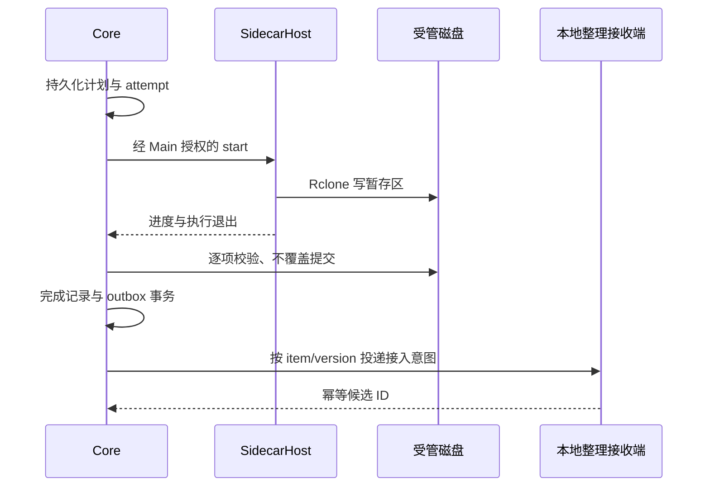

# 统一来源的桌面下载、整理与 Emby 入库设计

> 2026-10-27 已按用户要求历史归档；97/119 项完成，22 项迁出且未标完成。后续执行以[归档与任务去向](ARCHIVE.md)为准，本文执行指令及进度段落保留为历史记录；本次未同步主规格。

## 上下文

动机、能力清单与合并范围见[提案](proposal.md)。本文件是原桌面整理与内置下载两份方案合并后的设计依据；保留能力边界，共用迁移计划和任务清单，分别维护账号、同步来源与识别规则。2026-10-18 确定：一期为 monorepo 下的独立 Electron 客户端，React 重建界面，一期所需 Java 业务能力迁入 TypeScript；采用 `@yeatz/app-framework` 组织模块、服务、状态与生命周期。本变更仍解决本机网盘下载后的电影/剧集入库，产品目标不变；架构不再采用 Electron 启动 Java 服务，也不以同步交付 Web 版为门槛。

Emby 与下载均在用户电脑上，当前只开发和交付 Mac 客户端，非 macOS 客户端新增适配与兼容补齐由独立后续变更承接。普通目录来源接入夸克客户端下载目录或自定义目录；受管夸克授权、内置下载和周期扫描纳入同一变更，技术细节见第 10 节。应用不需要产品账户或用户部署后台；TMDB、Emby 及启用的网盘仍为外部网络依赖。

### 已观察到的项目基线

| 位置 | 现状 | 迁移含义 |
| --- | --- | --- |
| `frontend/` | Vue、Element Plus、Pinia、vue-i18n；相对 HTTP 和 STOMP | React 重建客户端，复用经核对的类型、纯函数、文案与交互语义；旧 Web 保留但不扩建 |
| `backend/src/main/java/com/mediamarshal/service/discovery` | WatchService、增量补扫、临时过滤；入口就绪检查不一致 | 在 TS 中统一事件和扫描入口，新增持久化候选 |
| `service/parser`、`service/matcher` | guessit 结果归一化、查询计划、父目录证据、评分、缓存、季集验证 | 迁移纯业务规则及失败语义，不能只保留简单名称搜索 |
| `service/rename` | 自定义模板语法、路径检查、普通视频及附属文件处理 | 迁移模板行为，强化真实路径和不覆盖提交，首版接入只复制 |
| `service/queue`、`service/correction` | 批量识别、确认、修正指纹和历史；恢复保证不完整 | 迁移核心交互并实现可持久化执行，故障场景优先于逐行翻译 |
| `model/entity`、`repository`、`config/Sqlite*` | JPA/SQLite；`ddl-auto=update` 与显式兼容 Runner 并存 | 新桌面库使用版本化 SQL，不复制 Java ORM 或直接复用旧库 |
| `parser/main.py` | FastAPI 只是 `guessit(filename)` 的薄 HTTP 包装 | 新增只依赖 guessit 的 stdio 入口，冻结为离线工具，不启动 HTTP 服务 |
| `EmbyLibraryRefreshService` | 内存刷新标记，无持久化收录核对 | 迁移 Emby 调用并补独立交付作业 |
| 后端测试与架构文档 | 已有模板、评分、季集、修正和恢复用例 | 作为语言迁移的行为基线，已知缺陷以新规格为准 |
| `LICENSE` | GPL-3.0 | 发行继续携带适用许可和源码获取方式 |

产品调研基线为 2026-10-17，代码与桌面选型于 2026-10-18 复核。官方资料证明支持能力，工程选择与性能假设仍需真实产物验证。个人 `desktop-app-engineering` Skill 作为选型参考，不作为必须安装全部依赖的模板。

表中省略前缀的 Java 模块路径均相对于 `backend/src/main/java/com/mediamarshal/`，对应测试位于 `backend/src/test/java/com/mediamarshal/`。

## 目标与非目标

**目标：** 一个安装包完成运行；React 提供首次配置、网盘、来源、识别与映射、任务、待处理与设置；TS 媒体核心负责识别、复制、恢复与 Emby 交付；窗口关闭后可继续工作。当前先在维护者自己的 Mac 上，将真实下载资源交付到已有 Emby 的指定媒体目录并核对收录。通过旧行为夹具与新故障测试保留媒体正确性，避免把服务端代码简单搬进主进程。

**边界：** 本变更不交付新 Web、远程 NAS 后台、账号支付、自动更新、Codex CLI 桥接或 SMTP；不接入音乐、ISO、蓝光和非复制入库。网盘来源与普通本地来源共用配置入口，账号、下载、整理及交付保持明确的执行边界。旧 Java/Vue/Docker 代码保留作参考及既有用户独立部署入口，不作为客户端回退服务或新功能双写目标。桌面数据独立，旧服务端库导入另立变更。

### 后续变更边界（2026-10-25）

本次范围为 macOS、中文界面、夸克网盘与通用本地目录整理、接入已有 Emby。非 macOS 客户端由 [add-non-macos-desktop-clients](../../add-non-macos-desktop-clients/proposal.md) 承接；自动安装与首次初始化 Emby 由 [add-emby-server-setup](../../add-emby-server-setup/proposal.md) 承接；语言切换、翻译补齐与本地化验收由 [add-desktop-localization](../../add-desktop-localization/proposal.md) 承接。这三项不属于本次任何里程碑或归档门槛。

已有平台与国际化基础保留，新增页面只要求完整中文。媒体解析、文件名和路径仍需正确处理 Unicode 与中英文；这不属于界面多语言。Mac arm64/x64 仍沿用本次架构验证计划。

### 网盘范围与扩展边界（2026-10-25）

本次只提供夸克账号、远端浏览、下载和周期扫描；外部下载客户端的专属来源引导及就绪行为也只验证夸克。百度、阿里等其他网盘的账号、品牌入口、完成判定规则和真实客户端验收留待后续需求，不属于本次里程碑。通用本地目录继续可用，但不推断文件来自哪个网盘，也不据此承诺该网盘兼容性。

保留 CloudDriveProvider、TransferEngine、能力声明、错误语义和静态注册表，业务状态机不绑定厂商私有字段。生产注册与账号／来源新建入口只启用夸克；OpenList 随包具备其他驱动不等于应用开放它们。既有独立 WebDAV 测试 Provider 只证明边界可替换，不进入产品入口，也不为满足扩展性新增其他真实网盘适配。

升级时若已有其他客户端标签，保留原始标签、目录、来源 ID、历史及暂停状态，界面按普通本地来源说明其客户端行为未验证；不得自动转换为夸克账号或套用夸克完成规则。继续遵守未知行为要求确认的现有策略，不删除配置或媒体。

### 平台范围与推进顺序（2026-10-24，范围于 2026-10-25 收敛）

当前只维护一个 Mac 产品，优先 Apple Silicon 上的真实功能、界面和安装体验，Intel 复用同一代码并按架构验证原生依赖和安装包。所有能力共用平台策略：二进制解析、凭据保护、进程回收、路径/卷语义和桌面集成由宿主适配，Core、Renderer 和业务 DTO 不写死 Mac 专有路径或命令。

Windows 现有资源映射、ACL/Job Object 实现及兼容测试保留，已有三目标结果继续作为历史证据；新功能不要求同步进行 Windows 验收，Windows 安装器、完整用户流程与正式签名由后续平台交付变更负责。Linux 等其他客户端也不进入本轮范围。Mac 功能开发和未签名内测不以公开发行的 Developer ID/公证配置为前提，公开正式发行仍须单独通过签名和安装态验收。

### 两类用户与当前里程碑（2026-10-25）

| 场景 | 用户已有条件 | 需要完成的流程 | 推进顺序 |
| --- | --- | --- | --- |
| 老用户 | Emby 已安装，已有媒体库及目标路径 | 复用连接，绑定指定目录，下载资源后整理复制并核对收录 | 当前先走通维护者本机链路 |
| 新用户 | 尚未安装或初始化 Emby | 协助安装及启动、首次账号设置、媒体目录和媒体库初始化，再进入同一交付链路 | 已迁入独立 Emby 初始化变更，本次不实现 |

当前以本机实际使用的一条下载来源和一个所需媒体类型的目标目录为起点，按需再验证另一媒体类型。实际服务器、媒体库标识、下载完成目录和媒体目标均取自已保存配置或用户选择；路径是运行配置，不作为开发者专属默认值。先读回服务器身份、库类型、库目录和读取/刷新权限，核对客户端目标可写及 Emby 可访问；证据不足时保留草稿和待处理状态，不猜测路径或改写服务器配置。

第一里程碑验证：连接账号 → 在来源中选择远端范围与同步 target，并在识别页配置输入与分类 target → 下载预览确认 → 受管下载完成 → 持久化接入意图 → 识别与必要的人工确认 → 目标预览 → COPY 到指定媒体目录 → Emby 刷新与收录核对。普通本地来源使用同一整理链路进行对照；下载、整理和交付分别记账，已有本地文件复制不能替代真实下载闭环。配置尚未就绪时保留下载成果及待接入状态。

本机验收记录应用构建、机器架构、服务器版本、脱敏目录对应关系、下载项与整理/交付结果，并覆盖重复提交、重启恢复和 Emby 离线后只重试交付。未实际读回和验证的本机配置不能记为已通过。其他架构、来源适配、批量修正、完整故障矩阵及公开发行按原任务继续推进，先后顺序调整不等于这些项目已完成。

## 决策

### 1. 市场定位：验证网盘下载后的本机入库体验

**判断：存在细分需求，付费规模未验证。** 区分需求证据与商业推断：成熟产品证明整理和自动化有人使用；这些证据不能推导付费人数、获客成本或市场总额。

| 类别 | 一手公开证据 | 对定位的含义 |
| --- | --- | --- |
| Emby 社区整理插件 | [Auto-Organize PLUS 作者](https://emby.media/community/topic/109245-auto-organize-plus-public-beta/)描述多监控目录、版本比较、处理中和待确认状态 | 整理、冲突提示、人工确认已有人提供；新产品须验证更低配置和修复成本 |
| Emby 内置生态同步 | [Folder Sync 官方文档](https://emby.media/support/articles/Folder-Sync.html)描述从库内内容复制或生成多分辨率副本，是 Premiere 功能 | 面向已有内容的备份与转出，不能视为外部资源下载入库 |
| Emby 频道插件 | [Sync Channel 作者](https://emby.media/community/topic/148783-plugin-ginjaninja-tools-sync-channel-radarr-sonarr-any-rest-api-channel-sync-tool/)描述从外部接口生成频道树，作者标记为早期测试 | 主要解决展示和即将上线信息，不能作为可靠下载闭环的证据 |
| 完整自动化 | [Sonarr](https://sonarr.tv/)、[Radarr](https://radarr.video/)、[MoviePilot](https://github.com/jxxghp/MoviePilot) | 强功能替代；Sonarr 已有 Windows 原生安装，桌面形式本身不足以区分 |
| 桌面媒体整理 | [FileBot](https://www.filebot.net/purchase.html)、[tinyMediaManager](https://www.tinymediamanager.org/) | 已有商业授权与桌面整理工具；应比较实际配置、中文识别和修复体验 |
| 新的一体化工具 | [Mediarium 自述](https://mediarium.app/)描述下载、整理和通知媒体服务器的一体化流程，提供 Docker 部署 | 集成多个工具本身也有竞争，介绍中的效果未经本次实测 |

优先用户画像：已有本机 Emby，经常从夸克网盘选择影视下载，但不愿部署维护完整自动化栈的人。重度追更用户及只想整理一次存量资料的用户属于次级人群。

免费工具交付“少配置、少误整理、出错能修好”的结果；后续官方识别与整理 API 的付费价值是免配置服务和更少的人工识别处理。本次围绕夸克受管下载与夸克客户端本地目录验收，通用目录使用同一整理流程。产品文案明确“夸克网盘与本地目录整理”，只宣传实际验收的能力，不将其他网盘列为已支持。夸克客户端的完成判定仍需以具体版本的磁盘行为夹具验证，不能只依据客户端名称自动放行。

### 2. 商业验证先于付费系统

以下是建议的实验门槛，属于团队设定的决策条件，不是市场统计或交付保证。

1. 访谈 10～15 位符合画像的用户，观察其真实目录、命名、下载和入库过程；记录每周频率、耗时和替代工具。
2. 邀请约 20 位 Mac 用户安装内测，覆盖夸克受管下载、夸克客户端目录及通用本地目录；至少半数在无实时协助下完成首次入库，再逐项定位失败原因。其他系统的用户测试留待相应平台交付，不作为 Mac 内测前置条件。
3. 以首次入库耗时、首次配置放弃率、一周后仍有使用者占比、人工修复次数为核心指标；未经同意不上传文件名、目录或库清单。
4. 桌面端与便捷、完整的整理核心免费，不测试桌面买断或更新续费。后续通过官方识别与整理 API 的体验额度和按量包验证付费意愿，关注真实付款、识别效果、复购、支持成本和退款原因；价格与额度待实测，不将口头好评视为购买证据。

商业路线分为免费整理工具、官方 API 按需付费、消息通知等会员服务三个阶段，完整边界、运营转化与候选价格见[商业与付费策略](../../../../docs/product/business-and-operations.md)。本变更仅交付第一阶段的桌面接入能力，不预建支付、账号、官方 API 或托管通知平台。基础保护、人工纠错和媒体服务器交付保持免费，自备识别服务的接入能力不以购买官方 API 为前提；接口支持范围按实际版本说明。后续官方 API 和会员服务另立变更，继续遵守现有开源许可。

### 3. 网盘、来源同步与识别映射的职责拆分

2026-10-26 产品调整：网盘只绑定登录；来源将目录或网盘范围单向同步到 target；识别模块配置规则并执行多目标映射。既有来源内 `organization` 属于待迁移实现，不继续作为目标模型。模块独立配置，完成事实负责交接，来源 ID 只保留追溯关系。

| 页面 | 用户要完成的事情 | 主要信息 |
| --- | --- | --- |
| 总览 | 判断各阶段是否正常 | 同步、识别映射、交付及待处理数量 |
| 云端网盘 | 绑定登录 | 连接、状态、重新授权、解除连接 |
| 来源 | 单向同步 source 到 target | 本地／网盘输入、同步目标、过滤、周期、预览、启停与同步历史 |
| 识别与映射 | 配置规则并执行映射 | 输入目录、识别、电影／剧集 target、命名、自动策略、Emby 关联和任务入口 |
| 任务 | 查看各阶段执行结果 | 同步、映射、交付的持久进度、失败和重试 |
| 待处理 | 核对具体资源 | 文件就绪、作品／季集、目标选择、冲突及整理预览 |
| 设置 | 公共配置 | 默认本地下载目录、TMDB、可选 Emby 连接、托盘与诊断 |

设置保留「本地下载目录」名称，作为新来源默认同步 target 与新识别规则默认输入。来源可显式选择其他 target；规则确认时解析并冻结具体目录授权及版本。更改默认值不改写已有绑定或任务、不搬动文件，既有配置改绑须重新预览。来源页移除媒体类型、媒体库目标和「下载后整理」开关。

网盘来源为「已连接账号 + 远端范围 → 同步 target」；本地来源为「本地输入 → 同步 target」，后者同样产生持久同步作业。用户只需同步时不配置 TMDB 或 Emby。已有普通目录也可直接作为识别输入，不强制先建立同步来源或额外复制。保存草稿不执行；完整范围预览后确认生效，执行一次与周期启用分开。账号连接导航返回保留来源草稿，旧订阅链接仍定位来源。

#### 3.1 配置身份、暂停与执行快照

`source_rule` 保留稳定 ID、来源类型、源引用、同步 target、过滤、周期、配置版本及暂停；不再保存识别策略。网盘订阅保留调度事实，本地来源复用同步计划与持久作业机制。`recognition_rule` 独立保存输入、就绪／识别配置、人工／自动策略、命名与版本；`recognition_target` 保存所属规则、类型和已授权本机路径，可关联经过验证的 Emby 绑定。具体表名为设计名，实施通过有序迁移落实。

同步、映射和交付保持独立状态机及幂等命令。活动同步冻结源版本和同步 target，活动映射冻结识别规则、媒体目标、模板与 Emby 路径转换版本；新配置不改变已受理操作。未确认预览因规则变更失效，活动操作到安全点后再切换。Renderer 只保存草稿和查询 DTO。

来源暂停只停止该来源新扫描和同步需求，协调活动同步到安全点；其他来源仍需要的共享同步可继续。识别规则对已有正式成果继续生效，暂停识别使用独立控制；识别暂停不阻止来源同步。恢复某阶段不解除其他阶段或全局暂停，删除配置不删除媒体和历史。既有全局云端下载暂停保持其阶段范围，本地同步提供来源及作业控制。

#### 3.2 同步与识别交接及目录授权

同步成果保留源对象、版本、来源需求及目标授权身份；独立识别规则按输入选择正式完成成果，outbox 与补扫复用同一资产版本候选。受管目录只接收有完成证据的文件，排除 staging 和未登记外部文件；普通目录可按就绪规则接入既有文件，但不伪造同步记录。识别未配置或暂停时同步照常完成，启用后补处理；成果缺失只报告输入问题，不反向命令来源重下。

同步 target 作为识别输入是合法交接。校验同步输入与同步 target、识别输入与媒体 target 的真实路径、卷身份、符号链接和包含关系，阻断循环及重叠识别接管。多个来源可共享同步根，但相同目标槽位仅一个写入者，不同文件同名时冲突；合法共享不等于自动认领外部文件。重选已授权目录复用原身份，取消不改变草稿，未知管理标记不自动删除或接管。错误指明冲突配置、阶段、可信原因和修复动作。

#### 3.3 多目标映射

每个识别 target 配置「映射类型 + 本机可写路径」，本次支持电影与剧集，允许一套输入对应多个 target。唯一类型匹配后沿用现有识别、季集和模板计划；未配置相应类型或同类多个 target 匹配时进入待处理，由用户选择并重新预览，不采用保存顺序或未经配置的分类猜测。更复杂的自定义分类谓词不作为本次隐含承诺。

映射任务立即返回持久作业 ID，提供预览、确认、执行、暂停、进度及独立失败重试；自动策略默认关闭，首次样本预览和授权归属于识别规则版本。媒体目标可使用已有目录或合法子目录，已有文件不自动成为整理对象。Emby 未配置或未匹配不阻断独立识别与 COPY；关联方式见第 8 节。

#### 3.4 rclone 规则基准与本地删除语义

沿用锁定 Rclone 运行时，以 [copy](https://rclone.org/commands/rclone_copy/) 的单向复制及不删除目标语义为基础；[sync](https://rclone.org/commands/rclone_sync/) 会删除目标多余文件，本次不开放镜像删除、move 或 bisync。copy 默认可能覆盖不同文件，应用继续先写隔离暂存、核验后不覆盖发布。不能直接对最终目录运行整树 copy 来代替业务决策。

过滤采用 [rclone 有序路径过滤](https://rclone.org/filtering/) 的首个匹配规则，首期支持相对根路径 glob 的 `+`／`-` 有序规则及 `*`、`**`、`?`；无匹配默认包含，只包含某范围须以 `- **` 收尾。普通扩展名／文件名控件转换为同一规范规则，未知语法在保存时拒绝；不开放任意 flags、过滤文件读取或 shell。Core 预览与执行使用同一枚举规则，实际传输仍是精确清单，避免二次过滤改变确认范围。通过锁定 Rclone 的真实临时目录对照验证公开子集，差异先修正再标兼容。

**成功同步历史优先于目标是否存在。** 应用保存独立 `sync_receipt`（拟名），标识源对象命名空间／稳定 ID（或路径身份）、源版本证据、同步目标授权／槽位、成功结果及关联请求。相同源对象、版本和目标的等价共享需求复用收据，改名来源、编辑周期、重新登录或重新创建等价来源不清除已同步事实。日志清理不能顺便删除防重同步收据。

原目录可访问且身份有效时发现成功文件缺失，记录「已同步，本地已移除」，后续周期、普通执行一次、重启与补扫均跳过同版本。无法可靠知道删除操作者，因此不区分人工删除和其他程序删除。原卷离线仅记不可用，不记删除；文件仍在但已修改记冲突，不覆盖。只有明确可靠的新源版本才能生成新同步候选；弱证据不能检测的更新保留跳过并说明局限。

用户显式「重新同步」经过预览确认建立新请求，保留历史及原收据，重复确认幂等，目标占用仍阻断。已成功但本地缺失不进入崩溃恢复重传分支；尚未成功记账的提交窗口继续按原磁盘证据恢复。仅凭缺失不能补造成功收据。修改同步 target 形成新目标范围，须在预览中明确将重新同步的文件。规则依据及应用差异均展示于帮助，不宣称完全等同 rclone 默认行为。

### 4. monorepo 与 TypeScript 客户端核心

用户选择 React，原因是界面复杂度可控且维护者熟悉 React；不以框架性能或 AI 生成正确率作未经测量的判断。采用 npm workspaces，沿用 npm 使用习惯，不同时引入 pnpm、Nx 或 Turborepo；若构建规模增长再评估任务缓存。

建议目录为：

```text
apps/desktop/
  src/main/             窗口、托盘、权限、凭据、生命周期
  src/preload/          最小业务 API
  src/renderer/         React 页面、组件、文案
  src/worker/           媒体 Utility Process 入口及进程适配
  src/sidecar-host/     Provider、Engine 与受管下载组件
                        各进程在自身 bootstrap 组装 Application/modules
packages/contracts/     Zod schema、DTO、命令与事件契约
packages/media-core/    TS 业务规则、存储与文件/网络适配
  src/domain/           评分、季集、模板、计划等纯逻辑
  src/application/      入库、确认、修正、交付用例
  src/infrastructure/   SQLite、文件系统、TMDB/Emby、parser 管道
  src/modules/          静态 ApplicationModule、服务标识和依赖声明
  migrations/           桌面库有序 SQL 迁移
  tests/fixtures/       脱敏行为及故障夹具
tools/desktop-parser/   guessit stdio 入口、冻结构建与依赖清单
tools/desktop-sidecars/ 网盘组件、Guardian、资源清单与故障夹具
vendor/yeatz-app-framework/  仅未发布时备用；本次使用已发布的精确版本
docs/                   现有文档站
backend/ frontend/ parser/  旧实现，保留原位置与构建入口
```

仅 `apps/*`、`packages/*` 进入新工作区；旧前端保留独立锁文件和构建，根文档站脚本保留。桌面发行以正向产物清单排除旧目录。新客户端不依赖旧 Vue 源码或 Java 运行时；需要复用的纯 TS 工具应明确迁入新包并迁移测试，不能靠跨目录引用使旧应用成为隐式依赖。

`contracts` 不依赖 Electron/Node 或应用框架，允许 Renderer 引用；`media-core` 不依赖 React/Electron，领域纯函数不依赖 DI，应用服务及模块层可使用框架核心入口，仅用必要的适配接口隔离存储、文件与网络；`desktop` 负责进程适配与最终组装。首版只有一个 UI 消费方，不先拆通用 `ui` 包，也不为未来 Web 编写 HTTP 适配。依赖方向为 desktop → contracts/media-core，media-core → contracts，禁止循环依赖和 Renderer 导入媒体核心。

| 层次 | 选择 | 原因与约束 |
| --- | --- | --- |
| 桌面运行时 | Electron | 核心迁入 Node/TS 后可以直接承载文件、网络与 npm 依赖，维护者无需同时引入 Rust 宿主 |
| 应用框架 | `@yeatz/app-framework` | 每进程独立 Application、静态 ApplicationModule、DI 与受管生命周期；按公开子路径导入，不代替 Electron 宿主或 IPC |
| 构建/分发 | electron-vite + electron-builder | 编译 Main/Preload/Renderer/worker，当前生成 Mac DMG，保留其他平台构建扩展；单一发布链路，首版手动升级 |
| 界面 | React + TypeScript strict、shadcn/ui、Tailwind CSS、语义 Token | 项目持有使用的组件源码，围绕入库任务重建；不机械翻译 Element Plus 页面 |
| 路由/文案 | React Router hash 路由；保留已有 i18next + react-i18next 基础 | 本地协议下导航稳定；本次只补齐中文和插值，语言设置与英文完整覆盖迁入多语言变更 |
| 状态 | StatefulService、computed、useServiceState；组件临时状态用 React | 框架内部已用 Zustand；应用不再另建全局 store，Renderer ViewModel 只保存核心 DTO 的视图与交互状态 |
| 契约 | TypeScript + Zod | 主进程校验来源及动作，核心再次校验业务约束；类型校验不替代授权 |
| 业务进程 | 单个 Electron Utility Process | 在带 Node 的应用子进程中执行核心，避免同步 SQLite、扫描与计算阻塞 Main |
| 数据 | better-sqlite3、显式 SQL、有序版本迁移 | 一处连接和业务写入所有者，短事务；不增加 ORM、不共享旧 Java 库 |
| 文件系统 | Node fs/streams/crypto；事件监听加周期核对 | 流式复制和摘要，有界并发；监听只是发现提示，补扫与就绪状态才承担正确性 |
| 网络 | 核心内集中 TMDB/Emby 客户端 | 超时、取消、代理、缓存与重试统一；Renderer 不持有服务密钥 |
| 名称解析 | 冻结 guessit 子进程、JSON Lines stdio | 暂保留解析质量，去掉 FastAPI/uvicorn 和监听端口；以后替换解析器需过同一夹具 |
| 测试 | Vitest、现有可迁移纯逻辑用例、Playwright Electron | 纯规则对照与真实文件/SQLite 测试结合，再做真实窗口及安装态验收 |

工作区能力依据 [npm workspaces](https://docs.npmjs.com/cli/v11/using-npm/workspaces/)，业务子进程依据 [Electron utilityProcess](https://www.electronjs.org/docs/latest/api/utility-process)，SQLite 依据 [better-sqlite3](https://github.com/WiseLibs/better-sqlite3)。同步数据库调用应保持短小、分页且可观测；Utility Process 不会自动消除其自身阻塞，长计算仍需分片或经测量后使用 worker，不让多个 worker 同时拥有业务库。

UI 接入依据：[shadcn/Vite](https://ui.shadcn.com/docs/installation/vite)、[Tailwind/Vite](https://tailwindcss.com/docs/installation/using-vite)、[React Router](https://reactrouter.com/start/declarative/installation)、[react-i18next](https://react.i18next.com/latest/using-with-hooks)。具体依赖、Electron 与 Node 组合在实现时锁定。Query、虚拟列表和动效库按实际需要引入，避免把参考栈变成依赖清单。

#### 4.1 应用框架的接入方式与职责

依据为本机 `/Users/zhangyichi/workspaces/wenger-repo/packages/app-framework` 的 `src/application/index.ts`、`src/ioc/`、`src/lifecycle/`、`src/command/commandService.ts`、`src/react/` 及包导出配置。2026-10-18 收尾复核时包名为 `@yeatz/app-framework`、版本为 `0.1.0`，仓库 HEAD 为 `002887f3537db2714e6bd5ea72c2ca9312f81b8e`，框架目录无未提交变更；实际接入时仍需重新记录所用源码与包校验值。框架采用 MIT 许可，继续在第三方说明中保留。

框架提供进程内服务容器、模块拓扑启动/逆序清理、命令注册、EffectScope/ScopedServices 和 React 状态订阅。它不提供 Electron 窗口管理、跨进程代理、数据库、文件事务、任务持久化或进程守护。采用框架后，原有安全及恢复约束仍需实现，不将生命周期自动清理当作崩溃恢复。

| 运行位置 | Application 与建议模块 | 数据和权限边界 |
| --- | --- | --- |
| Main | DesktopApplication：凭据、窗口/托盘、核心进程监管、受限 IPC | 拥有 Electron 原生能力与子进程句柄；不打开业务库 |
| Utility Process | MediaApplication：storage、parser、metadata、recognition、organizer、delivery、ingestion、业务命令入口 | 组装 media-core；独占 SQLite、任务与文件操作 |
| Renderer | RendererApplication：desktop-client、navigation、sources、tasks、review、settings | desktop-client 只包装明确的 Preload 方法；其他模块提供 ViewModel 和页面交互 |
| SidecarHost | 独立 Application：Provider、TransferEngine、连接与日志 | 不打开业务库，不决定扫描或发布业务完成；Guardian 持有原生进程 |
| Preload | 不创建 Application，仅实现最小类型化桥 | 不注入 DI 容器或媒体核心，不传服务实例 |

使用 `@yeatz/app-framework/application`、`/ioc`、`/lifecycle`、`/command` 等公开入口；只有 Renderer 引用 `/react`。不用 `/legacy` 或深层源码导入。所有容器、注册表和服务实例仅属于本进程 Application，不使用全局命令注册表。跨进程只传 contracts 定义的普通数据；DI 标识、AbortSignal、函数和服务对象不经过 IPC。

一期以静态 `ApplicationModule` 为单位，`register` 同步绑定、`start` 获取资源并启动、`stop` 做最终协调。所有模块先完成注册，再按 `dependencies` 顺序启动；注册阶段不解析尚未绑定的服务。Core 的 storage 最先启动并最后释放，parser/metadata 等适配先于依赖它们的用例启动，恢复完成前 ingestion 不启动发现和领取新任务，业务命令就绪后才上报核心可用。各模块声明实际依赖，避免靠数组顺序控制启动或通过跨模块内部字段绕过边界。

服务使用 `createIdentifier` 与显式 `@inject(Token)`；使用装饰器的 TS 编译启用 `experimentalDecorators`，采用框架当前的 legacy 装饰器语义，不依赖隐式参数类型元数据。首次原型同时验证 electron-vite 各入口及测试编译配置，避免开发态通过、打包后注入失败。简单规则仍是纯函数，不为每个模型创建类。资源只登记一个清理所有者：容器管理的 DisposableService、模块 effects 或 disposables 三者择一，避免重复关闭数据库、文件句柄或监听器。

Renderer 在组件树之外创建并启动 Application，再挂载 `ContainerProvider` 和 React 根。页面使用 `useService` 获取 StatefulService ViewModel，`useServiceState` 的 selector 订阅所需字段，computed 计算派生显示；输入草稿、弹窗等局部状态使用 React。ViewModel 通过 desktop-client 查询 DTO，不拥有可执行任务事实，也不序列化框架 snapshot 来自动镜像整个 Core。页面卸载取消该页面的轮询/订阅；应用级资源由 Renderer 宿主管理，StrictMode 重挂载不能创建第二个 Application 或销毁共享容器。受控重载先卸载 React 并等待清理；崩溃场景由进程终止和 Main 清理该窗口的请求补足，不能依赖异步 unload 回调一定完成。

框架 CommandService 只用于内部注册与分发，桥接层用固定业务方法映射已校验的命令，不提供 `execute(anyString, ...args)` 给页面。静态命令缺失立即报错，不能将注册等待伪装为业务运行；源码中的 `timeout` 和 `signal` 仅控制等待注册阶段，不会取消已经执行的 handler。请求执行期限、取消消息和 AbortController 由应用适配实现。复制/修正命令只返回已经持久化的作业 ID，后台调度另受生命周期管理；取消等待不等于取消作业，更不等于撤销已提交文件。

监听器、定时器、轮询和异步任务纳入模块 `effects`/`scoped`，执行的 Promise 必须返回或被显式登记，不能使用未受管的 detached Promise。框架 `stop()` 会先 abort/关闭作用域、等待 effects drain，然后逆序调用模块 stop 和清理资源；因此退出须由宿主先关闭业务入口、停止发现和领取、让活跃操作到达可恢复安全点，再 await Application.stop。不能把让长任务停止的唯一动作放在模块 stop 中，否则 drain 可能永远等不到它。SQLite 在活跃文件操作完成记账后才释放；宿主负责退出期限和必要的进程终止，强制结束靠日志恢复。启动中途取得的资源立即登记，不能只靠启动成功后才会调用的 stop 兜底。Application 一次性使用，停止或启动失败后重试必须新建实例。

动态 PluginRuntime、PluginBoundary 和能力热插拔首版不启用；框架内部具备这些机制不意味着产品需要插件市场。网盘标签仍共用一个目录接入模块，不能拆成三个虚构云端插件。

#### 4.2 框架依赖获取与验证

2026-10-18 对公开 npm registry 执行 `npm view @yeatz/app-framework` 返回 E404；package.json 已有 public publishConfig，但配置与提交记录不能作为包已上线的证据。首个实现从确认过的上游源码快照构建并 `npm pack`，将 `.tgz`、MIT 许可和来源清单放入 `vendor/yeatz-app-framework/`，使用仓库内相对 `file:` 包引用与 npm 根锁文件。清单记录上游 commit、可还原源码引用、构建工具版本、包内容摘要和 integrity；若实施时采用未提交修改，还需归档对应源码快照/补丁，不能只记录 `0.1.0`。

该目录保存固定依赖产物，不发展第二份框架实现；改进回到上游仓库，再通过显式更换快照更新。后续公开包可用时核对所需 API 和产物内容，通过单独依赖更新切换精确版本。个人绝对路径、跨仓软链接及全局安装只可用于临时开发联调，不进入正式锁文件或 CI；此前全局链接的偏好针对个人 Skills，不使应用运行依赖另一份可随时变化的源码。

实施复核时公开包 `@yeatz/app-framework@0.1.0` 已可取得，因此直接采用精确 npm 版本，不创建 vendor 副本。公开入口、类型、React 适配、真实 Electron DI 和包内许可已在本机验证；registry 未提供 gitHead，来源清单分别记录已评估源码 commit 与实际包 integrity，不声称二者构建字节一致。

本轮在上游当前工作树运行 typecheck、Jest、build 和包 smoke，全部通过：23 个套件、112 个测试，smoke 覆盖包导出、Node ESM/CJS、浏览器入口及 React 适配器。旧 hooks 测试使用 React 18 的兼容入口并有弃用警告，不能把 peerDependencies 中 React 16～19 的范围当作全部版本已验收。实际接入还须锁定 React/React DOM 的一致版本，验证 createRoot、StrictMode、选择性订阅、异步清理和真实 Electron 产物。实现任务必须覆盖干净 npm 安装、双进程隔离及打包后的装饰器注入，框架自身测试不能替代应用的业务与安装态验证。

#### 4.3 Java 能力迁移范围

| 原模块 | TS 目标行为 | 迁移证据 |
| --- | --- | --- |
| Discovery/WatchRule | 来源配置、忽略规则、增量发现、主动复查、暂停与补扫 | 目录事件夹具、缺盘不等于删除、重复发现只创建一个操作 |
| Parser/Matcher/TMDB cache | 名称字段归一化、搜索计划、父目录证据限权、置信度、缓存与季集验证 | 固定 TMDB 响应及旧测试期望；多季、合并集、特殊集和网络失败不误自动确认 |
| TemplateRenderer/PathSafety | 变量、补零、连续范围、可选片段、前后缀与安全目标路径 | 中英文、空值、连续集、非法格式、Windows 命名及中文首字母对照；pinyin4j 替代行为显式测试 |
| Pipeline/Queue | 持久化任务、候选、手动单条/批量识别与确认 | 编辑不执行整理，低置信度与季集冲突阻断，重复点击和重启幂等 |
| Rename/Correction | 视频和附属文件复制、已完成任务单条/批量修正、预览指纹和历史 | 不覆盖、过期预览、并发修正、复制/修正中强杀的磁盘核对 |
| Repository/Settings | 桌面 schema、迁移、有效配置、作业列表与历史查询 | 新库/桌面旧版升级、备份恢复、查询分页；凭据仅存引用 |
| Emby | 连接、刷新、分页查询与交付状态 | 实际 API 合约夹具、离线与认证失效只影响交付 |
| Controller/STOMP/Spring/JPA | 不逐项迁移框架层，业务动作改为进程命令 | 发行产物无 JRE、业务监听端口及旧服务依赖 |

先按现有测试提取输入/预期 JSON 夹具，Java 可在开发阶段生成对照，正式客户端测试不需要 Java。已知旧缺陷（例如普通任务恢复、路径物理隔离、内存刷新标记）按新规格修正，不为行为对照复制缺陷。字段命名可沿用既有语义，进程命令不要求兼容旧 REST URL。

### 5. 进程边界、凭据和生命周期

```likec4
specification {
  element system
  element component
}
model {
  desktop = system 'Media Marshal 桌面应用' {
    ui = component 'React 与隔离 Preload'
    main = component 'Electron Main：授权与生命周期'
    core = component '媒体 Core：同步、识别映射、SQLite 与恢复'
    host = component 'SidecarHost：Provider 与 TransferEngine'
    parser = component '冻结 guessit：离线名称解析'
    database = component '业务 SQLite：仅由 Core 读写'
    guardian = component 'Guardian：父管道与平台进程归属'
    openlist = component 'OpenList：网盘访问与只读 WebDAV'
    rclone = component 'Rclone CLI：批次传输'
  }
  quark = system '夸克网盘'
  disk = system '本机受管下载目录'
  localFiles = system '普通本地输入目录'
  tmdb = system 'TMDB 元数据服务'
  library = system '媒体库与 Emby'
  desktop.ui -> desktop.main '受限业务 IPC'
  desktop.main -> desktop.core '业务命令与状态'
  desktop.core -> desktop.main '内部基础设施请求'
  desktop.main -> desktop.host '授权执行与停止'
  desktop.host -> desktop.openlist '管理 API 与就绪检查'
  desktop.host -> desktop.guardian '受控执行与父管道'
  desktop.guardian -> desktop.openlist '启动与回收'
  desktop.guardian -> desktop.rclone '启动与回收'
  desktop.rclone -> desktop.openlist '只读 WebDAV'
  desktop.openlist -> quark '认证、列目录与代理读取'
  desktop.rclone -> disk '写暂存区'
  desktop.core -> disk '校验与不覆盖提交'
  desktop.core -> desktop.parser '受控 JSON Lines'
  desktop.core -> desktop.database '配置、任务与恢复记录'
  desktop.core -> localFiles '本地同步或直接识别的就绪核验与读取'
  desktop.core -> tmdb '元数据查询与证据'
  desktop.core -> library '识别、COPY 整理与 Emby 交付'
}
views {
  view desktopIngestion {
    include *
    include desktop.*
  }
}
```

独立客户端允许应用内部多进程；不会启动 Spring Boot、FastAPI、媒体 HTTP API、STOMP broker 或远程执行端。媒体业务通过 IPC；受管网盘的回环 API、SidecarHost 和 Go 子进程按第 10 节管理。Main 管理窗口、托盘、目录选择、凭据、外部链接及生命周期，媒体核心负责数据库、文件、识别和调度。utilityProcess 具备 Node 权限，安全边界仍是最小 IPC、参数/路径校验、可信代码和原生权限。

Renderer 仅加载打包页面，使用稳定自定义协议和 hash 路由，启用 contextIsolation/sandbox，关闭 nodeIntegration，限制导航、新窗口和 CSP。Preload 只暴露来源、预览、确认、任务查询等具体方法；不暴露任意 channel、SQL、URL 请求、文件系统或 shell。Main 校验 sender frame/origin、动作白名单、输入大小和授权目录；核心执行时再次解析真实路径并检查规则和资产状态。参考 [Electron 安全指南](https://www.electronjs.org/docs/latest/tutorial/security)。

Main 与 Utility Process 通过私有父子消息通道传递 requestId、命令、结果和错误，握手核对协议/数据格式版本；不以可猜端口或 PID 当身份。重启核心时所有旧请求返回明确中断结果，恢复后先查持久化状态，不自动重放复制/确认命令。查询可取消；长操作返回已持久化作业 ID，UI 通过受限查询轮询进度。日志和消息有界，不传输视频二进制；React 重挂载不会重复创建作业或轮询。

Core 通过直接 spawn 的受控子进程调用冻结 parser，禁止 shell 拼接；stdin/stdout 使用有 requestId、长度上限、超时和 schema 校验的 JSON Lines，日志只写脱敏 stderr。名称文本是数据，不接受任意脚本/路径执行。解析器串行或有界处理，超时/异常重启后重新解析尚未完成的只读请求；stdin 关闭或父进程丢失时退出。该 stdio 协议用于 parser 子进程；Main 与 utilityProcess 使用 Electron 消息通道，不使用其不支持的 stdin 管道。

敏感凭据在用户显式输入时仅经受限设置动作交给 Main，使用 [safeStorage](https://www.electronjs.org/docs/latest/api/safe-storage) 保护权威副本；普通查询只返回是否已配置和脱敏信息。Core/SidecarHost 经私有通道取得所需内存值，业务 SQLite 只保存引用；密钥不写命令行、日志或 UI 持久化状态。OpenList 私有库等运行副本按第 10 节限制权限并排除普通导出，不宣称全量加密。TMDB 代理仍只作用于 TMDB，不默认代理本机 Emby 请求。

启动流程为单实例锁 → Main 桌面能力就绪 → Utility Process 打开并迁移数据库、恢复操作 → parser 就绪 → 允许新接入。UI 可提前显示组件状态，失败最多自动重启三次并递增等待，之后等待用户处理。重启前确认旧核心退出，禁止两个核心访问同一库。Main 异常退出时核心检测父通道关闭并停止接入、安全退出；parser 随核心管道关闭退出。父进程强杀与崩溃通过安装态故障注入验证无残留写入者，未验证不能声称清理可靠。

关闭窗口保留托盘，首次关闭说明；显式退出停止接入和新作业，等待复制/修正安全点，完成记录与数据库关闭，再终止自有子进程。超时强制退出保留恢复证据，绝不按进程名批量杀进程。登录启动默认关闭；不安装系统服务、不承诺注销或关机后处理。唤醒重置文件稳定窗口并补扫。

Main 和 Renderer 均不打开业务 SQLite；Core 采用单连接短事务、唯一约束和显式 schema_version，文件操作不能包在数据库长事务内。UI 存储仅保存偏好，重载或缓存丢失后仍可查询未完成入库/修正作业。首次安装不读取浏览器 localStorage 或旧 Java 数据目录。

桌面基础 schema 保留规则、任务、候选、配置引用、TMDB 缓存及修正作业/条目的业务概念，字段及索引按客户端查询和唯一约束定义，不要求与 Java 表结构二进制兼容。模型明确区分解析字段、用户确认字段、元数据证据、文件状态和交付状态，提供分页任务及作业列表；不能用 Renderer 的本地索引作为恢复入口。基础表与后续来源/操作/交付表使用同一套版本迁移。

**备选：** Tauri 2 复用系统 WebView，但本次核心改为 Node/TS，采用它还需 Node sidecar 或 Rust 重写，收益须以完整部署测量；其 [macOS WebDriver 路径](https://v2.tauri.app/develop/tests/webdriver/)已存在，不以测试缺失排除。把所有逻辑放 Main 更简单，却放大阻塞和崩溃影响，故采用一个业务 Utility Process。首版保留 guessit 降低同时重写解析和整理的风险，只有同一解析夹具通过后再评估纯 TS 解析器。

### 6. 下载完成只能按证据判断

本地同步输入和直接识别输入共用就绪检查，客户端标签仅保存说明、经验证的临时文件规则及兼容版本记录，不硬编码猜测的下载目录或后缀。当前只验证夸克官方客户端的正常下载、暂停、预分配、断网、退出、完成改名及同名重下，其他标签按未知行为处理。

所有发现入口汇入持久化候选表。候选观察路径真实值、文件标识、大小、修改时间及下载标记。采用至少 120 秒稳定窗口，每 10 秒复查；零字节、仍在写入、临时名称、不可读或已知标记存在时继续等待。使用单调时钟，进程重启或系统唤醒后重新建立窗口；延迟候选独立调度，不受目录修改时间缓存影响。

**文件稳定和校验复制只能证明观察期间未变动，不能证明预分配文件或长时间暂停的下载已经完成。** 不把这类启发式描述为官方完成状态。只有经实测的来源行为、没有不确定标记且用户显式开启时才自动接入；客户端行为未知或预分配情况不明时要求用户到官方客户端确认。本地同步展示自身复制进度，不冒充上游客户端下载进度；直接识别输入只展示观察与识别状态，网盘同步按真实传输证据展示进度。

无需用媒体探测工具能够读取容器头作为完整性证明：部分视频在未下载完成时也可读。相较只延长稳定等待，本设计明确保留人工确认降级，降低错误自动化的代价。

### 7. 复制、去重和恢复

来源同步与识别映射均保留源文件；识别映射强制 `COPY`；旧 Docker 的 MOVE/HARD_LINK/SYMBOLIC_LINK 实现保留在旧目录，不迁入一期客户端。复制的代价是磁盘空间增加；相比默认移动，它能保留官方下载客户端的原文件视图，也避免硬链接两侧修改同一内容的问题。

来源同步与识别规则分别拥有配置和任务，关联及交接见第 3 节。目标必须在本机可访问、经过目录授权与文件系统能力验证；允许显式 Emby 路径转换，不据此宣称所有 NAS 协议或卷均已兼容。保存和执行复核真实路径、卷身份、系统权限、循环与重复接管，不因显示路径匹配放宽写入边界。

老用户可直接选择已有媒体库根目录或其合法子目录作为整理目标，不要求空目录或应用专属根目录；已有媒体不自动成为重新整理对象。电影与剧集目标独立配置，只为本次所需类型选择和绑定目录。受管下载暂存/完成目录仍与媒体目标分离，所有来源交接后复用已绑定的目标配置；缺少相应类型绑定时等待配置，不自动落到新建默认目录。

新增逻辑记录（表名为拟定实现名）：

| 记录 | 核心字段和作用 |
| --- | --- |
| `recognition_rule/target` | 识别输入、类型目标、自动策略、规则版本、暂停、授权和健康状态 |
| `ingestion_candidate` | 来源、规范路径、文件标识、大小、修改时间、观察阶段、下次检查时间、关联任务 |
| `ingestion_operation` | 唯一资产版本键、计划指纹、源/临时/目标路径、内容摘要、操作阶段、错误及关联桌面 MediaTask |
| `emby_delivery` | 操作引用、连接版本、目标库、目标文件、刷新和核对阶段、重试时间、Emby 条目标识 |

识别发现键使用输入授权身份与规范路径，受管成果另绑定完成项版本；同步来源只提供追溯关系。资产去重不因多个来源需求重复。资产版本由文件标识、属性快照及核对摘要组成；数据库唯一约束结合领取操作防止并发重复。对来源目录按已知候选定期复查文件属性，不能仅靠目录修改时间发现原地更新。完成文件在周期核对中若版本证据变化则重新观察；同路径同属性的静默内容替换只能通过显式全量内容复核识别，界面应提供该动作。

操作状态拟定为 `PLANNED → COPYING → VERIFIED → FILE_COMMITTED → RECORDED`，异常进入 `WAITING_SOURCE` 或 `NEEDS_ATTENTION`。先记录计划并申请资产版本，再在目标目录同卷写带操作标识的隐藏临时文件；复制时计算 SHA-256，再读取来源计算摘要，比较前后属性与摘要，必要时检查目标临时内容。摘要一致仍不宣称云端下载完整。

提交时必须使用经平台验证的“不替换已有文件”的原子创建机制；不能仅做 `exists` 后再覆盖式移动。若平台无法保证，阻断提交并提示。主视频与附属文件逐项保留操作日志；用户可见主文件已完成而某字幕仍待处理，交付须等必需主文件提交后才通知，附属失败可独立重试。

只有自己的临时文件可以自动清理；正式目标恢复时必须有当前操作路径、文件身份和内容摘要证据。崩溃恢复发现目标已提交则补记数据库，不重复复制；证据冲突停留待处理。SQLite 的事务只管理记录，不声称文件系统原子事务或整批自动回滚。规则删除、编辑和重置要等待活跃操作安全退出，不能复用当前不感知桌面操作的直接删除路径。

已完成媒体修正使用独立的修正计划和逐项文件日志，保留原任务/新任务历史关系。同季/同剧范围由核心从数据库计算，不受 UI 当前分页限制；预览保存成员和目标指纹，执行时重新核对并领取活动占用。修正仅操作已整理的目标文件及附属文件，保留来源；同卷使用经验证的不覆盖改名，跨卷以复制、校验、提交、最后删除有确切归属的旧目标分阶段记账。崩溃后允许新旧目标暂时同时存在，依据路径、身份和摘要恢复，证据不足要求处理，不能自动删文件来消除冲突。批次逐项推进、失败独立重试，单项文件提交与新旧任务记账同样存在需要恢复的窗口，不沿用 Java 只依靠内存补偿的假设。

### 8. Emby 交付是独立作业

Emby 为可选交付连接。配置后读取服务器身份、库类型、全部库路径及读取／刷新权限，自动发现每个识别 target 属于哪个库：路径等于库根或在其子目录且类型兼容时匹配，唯一匹配保存版本化关联，多重匹配或不兼容显示待确认。目标配置先于 Emby，未连接／未匹配不阻止独立识别和 COPY；交付未验证不发送刷新或显示收录成功。绑定不创建、改名或改写 Emby 库，不安装或重启服务。

不同路径命名空间由用户明确配置「本机根 → Emby 根」。本机侧经过原生授权和真实路径校验，服务端侧按服务端路径语义做路径段包含及越界校验，保留相对路径；不能用字符串 startsWith 或同名目录猜测。一个库有多个路径时记录命中的具体根；重叠转换产生歧义则阻断关联。展示两侧完整目标供核对，文件写入只使用本机路径，收录查询使用转换后的 Emby 路径。服务器、库路径或转换版本变化使旧证据失效，修复后只重试交付。

文件提交和交付意图在同一次数据库事务中补记；启动协调器还要从 `FILE_COMMITTED` 的操作补建缺失交付，覆盖文件已提交但事务前崩溃的窗口。交付按服务器连接版本持久化，30 秒内合并刷新；离线采用 30 秒、1 分钟、2 分钟直至 15 分钟上限的退避，认证失败转待处理。

先复用 `POST /Library/Refresh`，其含义是开始扫描且要求管理员权限，不能把成功响应等同于收录完成，见 [Emby 官方接口](https://dev.emby.media/reference/RestAPI/LibraryService/postLibraryRefresh.html)。不在本轮虚构按路径精准扫描已受支持；未来有性能需要再评估更细通知。

通过所选库分页获取必要字段，匹配经绑定转换后的服务端目标路径、ProviderIds、媒体类型和季集；路径一致但元数据不一致显示待处理。缺字段不能只凭标题关联，参考 [Emby 浏览接口文档](https://dev.emby.media/doc/restapi/Browsing-the-Library.html)，实现须用实际支持的服务器响应建立合约夹具。

扫描成功后每 15 秒核对一次，最多主动查询 10 分钟；超时显示检查指引，用户可只重试交付。批量任务共享库查询结果，避免逐文件拉全库。保存 itemId 和核对时间，打开链接只包含正常 Web 路由，不带 API Key。连接变更使旧证据失效。总览分别统计“文件已整理”和“Emby 已收录”，在 TS 模型中保留 `MediaTask.DONE` 的文件语义。

### 9. 自包含发行、桌面数据升级与验收

electron-vite 编译客户端各进程入口，electron-builder 当前生成 macOS arm64/x64 DMG，按已通过验证的架构提供包；Apple Silicon 优先。Windows 构建入口和资源选择结构保留，其 NSIS 安装器不要求本轮交付。Mac 支持基线暂定 macOS 14，须在该系统实测，不能用较新系统的 CI 结果替代；不在本轮声明 Windows 首发支持。参考 [electron-vite 分发](https://electron-vite.org/guide/distribution.html)。当前没有既成 Forge 构建，采用单一新链路；不引入 electron-updater。

better-sqlite3 按目标 Electron ABI 和平台架构重建，作为原生依赖正确解包；冻结 parser 使用 PyInstaller 目录模式，位于 ASAR 外的资源目录。所有运行依赖随包提供，用户无需安装编译器、Python、Java 或 Node。干净环境验证原生库加载、只读安装目录、中文/空格路径及进程启动。参考 [Electron 原生模块](https://www.electronjs.org/docs/latest/tutorial/using-native-node-modules)。不打包旧 backend/frontend/parser 服务、JRE、开发凭据或媒体样本。

Mac 按架构原生构建并记录应用、Electron、SQLite 模块与 guessit 版本和许可。功能验收、未签名内测包及正式发行分别记录；公开发行前，macOS 应用及嵌套二进制须完成 Developer ID 签名、公证和安装态验收。当前没有签名配置，相关任务保持未完成，不阻塞功能开发或内部验收，不用 dev server 或未签名包宣称正式发行完成。其他平台启用时再补相应安装器、签名和安装态验证。

用户数据保存在系统应用数据目录，桌面 schema 从新库独立开始。显式、有序 SQL 迁移先于调度和文件访问；未知版本或失败时停止接入。升级前核心协调安全点、执行 SQLite 一致性备份并保留密钥引用相关配置，WAL 模式不得只复制活跃主 DB 文件。旧版本拒绝写入不兼容数据，回退使用对应备份并重新核对磁盘，不声称还原 DB 会撤销文件操作。旧 Java 库导入不在一期内，亦不承诺将桌面数据反向同步到 Docker。

官网下载页标明架构、最低系统、变更说明、校验值和客户端前置条件。用户手动下载安装升级，卸载不删除数据、来源或媒体。商店发行另立变更。许可和元数据来源继续展示，商业 API 安排见既有产品规划，不在此实现账号、支付或托管服务。

验证分为业务夹具对照、真实临时文件/SQLite 故障测试、Electron 窗口、安装态四层，安装态分别标明未签名内测或正式签名发行。Vitest 运行规则和核心测试；[Playwright Electron](https://playwright.dev/docs/api/class-electron)目前是 experimental，锁定并验证版本组合。原生对话框/托盘/权限和完整进程树退出先在 Mac 做 OS 实测。记录同设备多次冷/热启动 P75/P95、安装体积、完整进程树空闲 CPU/内存、交互延迟和复制/校验吞吐，不先填写虚构性能目标。

### 10. 内置网盘与传输子系统

采用 OpenList 提供网盘访问、Rclone CLI 执行传输、Core 持有业务状态。以下细节从原内置下载方案并入，能力标识与已验证契约保持可追溯，实际完成状态见统一任务清单。

#### 10.1. 进程所有权与模块落位

Main 是唯一桌面宿主控制入口，管理凭据和组件生命周期。新增一个轻量 `SidecarHost` Utility Process，持有 Provider/Engine、HTTP 连接与日志流，通过独立 Guardian 持有 OpenList/Rclone 的 OS 子进程句柄。Host 不打开业务 SQLite、不决定调度、不持有业务真相；它执行受限基础设施动作，配合 Guardian 在父通道断开后回收 Go 子进程。生命周期保证不能仅依赖 Electron 的正常退出钩子。

M0 实测修正：Main 被强杀时 Utility Host 也可能被 Electron 立即终止，单靠 Host 的父通道回调不足以回收 Go 进程。进程执行层必须增加应用自有的独立原生 Guardian：Host 通过保持打开的 stdin 管道管理它，管道 EOF 触发回收；既有 Windows 实现以带 KILL_ON_JOB_CLOSE 的 Job 管理子进程，作为历史基础保留，新增适配与验收由非 macOS 变更承接。Guardian 不持有账号业务状态。Main 另保留从自有子进程事件取得、经过父子关系/创建时间/唯一配置路径核对的进程身份，用于 Host/Guardian 故障时清理。M0 原型位于 `tools/desktop-sidecars/guardian/`，正式宿主接线和资源分发仍由后续任务完成。

Core 负责扫描计划、队列、状态机、文件核对/提交及交接。Core 发出内部宿主请求，经 Main 校验并转发给 SidecarHost；结果携带 `coreGeneration`、`attemptId`、序号，经 Main 路由回 Core。长任务返回 ID，不占住现有 15 秒 RPC 等待窗口。Core 退出时 Main 立即撤销其代际并停止对应执行，确认停止后才能授权新核心领取。

各进程继续使用独立的 `@yeatz/app-framework` Application 与静态模块；内部反向 RPC 使用专有白名单，不向 Preload 暴露。

| 拟新增位置 | 职责 |
| --- | --- |
| `packages/contracts/src/cloud/` | 账号/节点/作业 DTO、业务动作及错误；不包含凭据和临时 URL |
| `packages/contracts/src/internal/` | Main↔Core↔Host 内部消息、传输结果；禁止 Renderer 导入 |
| `packages/media-core/src/cloud/` | 订阅、扫描、增量计划、队列、下载仓储、提交和交接 |
| `apps/desktop/src/main/cloud/` | 凭据保险箱、宿主代理、进程代际、原生目录授权 |
| `apps/desktop/src/sidecar-host/` | Provider 注册、OpenList 客户端、Rclone 引擎、进程监管 |
| `apps/desktop/src/renderer/src/pages/` | 账号管理、统一来源内远端选择和下载任务；沿用框架 ViewModel |
| `tools/desktop-sidecars/` | 构建期下载、校验、版本清单和许可材料 |

整体架构统一见第 5 节的 LikeC4 模型。

#### 10.2. 控制面和传输面分开抽象

仅包装 OpenList REST API 不足以解耦：如果任务表保存 WebDAV 路径，或 Rclone 直接读取 OpenList 挂载 ID，后续替换仍需改业务。使用下面三个边界，领域层只保存账号、远端引用和版本证据。

```ts
// 设计草图；所有类型为应用自有类型，具体 Schema 在实施时补齐。
interface CloudDriveProvider {
  readonly implementationId: string;
  capabilities(account: AccountRef): Promise<DriveCapabilities>;
  validateCredential(input: PrivateCredentialInput): Promise<AccountIdentity>;
  list(input: ListInput): Promise<RemotePage>;
  stat(input: RemoteRef): Promise<RemoteEntry>;
  acquireSource(input: SourceRequest): Promise<TransferSourceLease>;
  releaseSource(leaseId: string): Promise<void>;
}

// 只存在于 SidecarHost 内部；业务库保存 sourceRequest，不保存本对象。
interface TransferSourceLease {
  leaseId: string;
  generation: string;
  kind: "webdav";
  endpoint: string;
  root: string;
  credentialHandle: string;
  expiresAt?: string;
}

interface TransferEngine {
  readonly supportedSourceKinds: readonly string[];
  start(input: PrivateTransferPlan): Promise<ExecutionHandle>;
  stop(handle: ExecutionHandle): Promise<StoppedExecution>;
  events(handle: ExecutionHandle): AsyncIterable<TransferEvent>;
}
```

`TransferSourceLease` 首版只实现 `webdav` 判别分支。未来需要 `http-object` 时扩展内部联合类型和引擎能力，不预先写空实现。Provider 和 Engine 在 Host 内通过能力协商连接；Core 不认识 `dav/`、`quarkdav:`、Rclone flags 或 OpenList storage ID。

关键类型约定：

- `DriveCapabilities`：授权方式、`stable-id | path` 身份等级、可靠版本/hash 可用性、范围读取与可提供的 source kinds。不能因上游支持某功能就默认当前驱动也支持。
- `RemoteEntry`：应用 `remoteRef`、名称、类型、大小、可选时间/摘要/版本及证据等级。上游 ID 只保存在实现绑定中；无稳定 ID 时明确退化为规范路径身份。
- `TransferEvent`：进度、执行退出与可核对文件证据，不直接产生业务 `COMPLETED`。Core 核对后才提交成功。
- 统一错误：`AUTH_REQUIRED`、`RATE_LIMITED`、`NETWORK_UNAVAILABLE`、`REMOTE_CHANGED`、`REMOTE_NOT_FOUND`、`LOCAL_UNAVAILABLE`、`UNSUPPORTED_CAPABILITY`、`COMPONENT_UNAVAILABLE`、`CONFLICT`、`INTERNAL_ERROR`；可带受限 `retryAfter`，不把上游原始消息直接展示。

Provider/Engine 使用静态注册表和 DI，生产只注册夸克网盘接入，不允许用户传任意模块路径、二进制路径或 shell 参数。用假的 Provider 与 Engine 运行同一业务测试，并增加一个独立测试 WebDAV Provider，证明下载不依赖 OpenList 特有字段。

#### 10.3. OpenList 仅作为受管网盘网关

新增 `OpenListQuarkProvider`，通过固定版本的公开管理/文件 API 管理账号挂载、列目录和查询元数据；不直接读写 OpenList 数据库。应用生成隐藏的内部挂载命名，与用户可编辑的账号名称无关。OpenList 数据丢失时，以凭据保险箱和实现绑定重建挂载，重新验证远端引用。

重新授权必须核对网盘账号身份；新 Cookie 属于另一个账号时拒绝覆盖原绑定，改走新增账号和范围预览。接入实现无法给出可靠账号身份时，不自动沿用旧目录授权，要求重新选择并核对订阅根。

普通夸克驱动的官方文档要求 Cookie，当前说明采用本地代理；该文档同时提示相关历史逆向接口不主动维护。首版选择普通 Quark 驱动，不把 Quark TV/Open 的授权或 302 行为混用；正式版本必须通过真实账号验证。[OpenList 夸克驱动文档](https://doc.oplist.org/guide/drivers/quark)

初始化顺序：校验包内版本 → 写安全配置 → 启动实例 → 建立私有管理授权 → 关闭匿名访问 → 创建仅 WebDAV 读取权限的账号 → 注册挂载 → 验证列表与读取。管理 API 不假定跨版本稳定，路径、字段与初始化 CLI 用锁定 tag 的源码/API 契约固定，失败即停止启用。

配置显式设置 `scheme.address=127.0.0.1`，不要沿用上游默认监听全部地址。使用应用分配的高位端口；探测空闲端口与实际绑定间存在竞争，应在绑定失败后有限重选，并通过自有进程状态及私有授权核验实例，不能连接未知的现存 5244 服务。[OpenList 配置](https://doc.oplist.org/configuration/configuration)

首个启用的云端账号触发启动，之后在应用后台期间常驻。没有云端账号时不启动；云端故障不阻塞本地来源。OpenList 的 WebDAV 授权只开放读取；其读取与管理权限可分开配置。[OpenList WebDAV 权限](https://openlistteam.github.io/docs/guide/webdav.html)

#### 10.4. Rclone 按批次执行，先不用 rcd

每个活跃传输批次一个 CLI 进程；同一账号首版只运行一个批次，批次内部初始 `--transfers 2`、`--checkers 2`、`--multi-thread-streams 1`。这些是保守默认值，需以真实账号限流和设备数据调整，不是性能保证。多个订阅共享账号预算，禁止并发相乘。

Core 枚举后生成有界、不可变文件清单；同根、同凭据、同目标隔离区的文件组成批次。逻辑上的一次下载作业可以包含多个批次，避免百万文件单进程和整棵目录重新扫描。源路径映射和文件列表由 Host 生成，禁止把远端名称解释成参数或 glob；换行等无法由锁定版本清单接口无损表示的名称使用单文件安全路径或明确拒绝该项。

传输采用 `copy` 加精确清单，单文件可使用 `copyto`；只写新的 attempt 暂存目录。应用先完成增量决策，不将整棵目录 `copy --size-only` 作为调度器。`copy` 不同步删除目标，但可能覆盖目标中的不同文件，因此不能直接面向最终目录运行。[Rclone copy](https://rclone.org/commands/rclone_copy/)

启用 JSON 日志、1 秒统计和匹配的日志等级；逐行解析采用最大行长、有界缓存和未知字段容忍，输出归一化到约 1 Hz。日志夹具必须来自锁定版本。进度只是观测，退出码和逐项文件核对决定结果；重试字节分 attempt 统计，最终成功进度只累计已核对内容。CLI 自身短暂重试与应用退避共用总预算，不能两层无限重试。[Rclone 日志与统计参数](https://rclone.org/docs/)

暂停实现为终止当前进程并等待退出，再标记 `PAUSED`。恢复跳过已提交项，对未完成文件创建新 attempt；首版不承诺字节级断点续传，范围请求能力也不等于跨进程续传能力。取消只撤销剩余执行，不删除已提交文件。

当 CLI 的结构化状态确实不足时，增加 `RcloneRcEngine` 实现相同接口；届时内部 RC job ID 仍不进入领域标识。RC 已提供异步作业、停止和统计接口，但扩大了本地控制面，首版没有必要新增常驻 5572 端口。[Rclone RC](https://rclone.org/rc/)

#### 10.5. 应用拥有增量状态与调度

业务 SQLite 使用增量迁移。统一来源配置与迁移见第 3 节及本文迁移计划；不迁移或导入 OpenList 数据库作为业务事实。

| 表/记录（拟） | 关键内容 |
| --- | --- |
| `cloud_account` | 应用 UUID、provider kind、状态、credentialRef；无明文凭据 |
| `provider_binding` | accountId、implementationId、配置版本、generation、非敏感私有映射 |
| `source_rule`（拟） | 同步来源 ID、输入、同步 target、过滤、配置版本和执行关联 |
| `sync_receipt`（拟） | 跨来源等价需求的成功同步记录、本地移除状态及显式重同步请求关联 |
| `cloud_subscription` | 关联来源的当前周期扫描配置及运行状态，保留账号、远端根和落盘引用；与来源通过统一命令维护 |
| `cloud_scan` | 扫描代次、游标、完整性与时间；分页失败不生成删除结论 |
| `remote_entry` | 应用引用、实现映射、路径、元数据、版本证据与最后观察代次 |
| `download_job/item` | 需求关联来源 ID／配置版本，保存范围快照、条目版本、目标槽位、状态、幂等键及结果指纹 |
| `download_attempt` | item/批次、核心及绑定代际、执行 token、临时路径、重试、退出证据 |
| `ingestion_outbox` | 已提交 item/version → 本地候选；唯一键、投递状态和确认记录 |

以“账号 + 远端引用 + 版本证据 + 目标槽位”归一化同内容请求，用唯一约束或关联表使重叠订阅复用同一下载项；同目标槽位仅一个活跃写入者。订阅配置变更递增版本，未执行计划重新预览，活动 attempt 使用不可变快照。扫描期间 root 不可达、分页失败和目录改名都不表示删除。

共享下载项保留各作业/订阅的需求关联。取消单个作业仅解除其需求，仍有其他有效需求时继续传输；账号级暂停才停止整个账号。最后一个需求取消后才终止共享执行并按规则清理暂存区。

版本比较优先级：可靠 provider revision/hash → 经验证的源元数据组合 → 路径与尺寸弱比较。mtime、ETag 不因字段存在就视为内容版本。普通 WebDAV 不提供可依赖的通用摘要/修改时间能力，因此 OpenList 管理 API 的源元数据与传输接口能力分别记录；实际拿不到可靠证据时，在 UI 明示弱比较。[Rclone WebDAV 能力](https://rclone.org/webdav/)

增量决策先查成功收据：同版本已同步，即使成果后来被本地删除也跳过；原卷不可用和内容被修改分别报告不可用／冲突。可靠的新版本创建新候选，弱证据不得因本地缺失推断更新；显式重新同步经预览生成新请求。所有模式保持不覆盖，不把本地 SHA-256 当作远端内容正确性证明，详见第 3.4 节。

订阅默认周期建议 15 分钟，可配置；账号级抖动、退避和限流优先于该周期。应用退出期间不运行订阅；启动/唤醒后合并漏过触发为一轮补扫。用户显式启用自动下载后才持续运行。

#### 10.6. 暂存、提交与媒体整理交接

用户在设置中授权默认本地下载目录，来源选择该目录或显式 target。应用管理 `.media-marshal/staging/<attemptId>/` 与正式完成区，两者在同一已验证卷上；完成区及相对目录结构在预览中明示，下载与本地同步采用相同交接约束。授权复核 realpath、卷身份和可写性；缺盘不创建替代目录。同步 target 可供独立识别规则输入，不能与同步输入或媒体输出形成循环；受管补扫通过完成记录去重，暂存及未登记外部文件不接收。

落盘映射公共层检查 `..`、绝对路径、分隔符、越界与目标占用；目标平台策略处理卷身份、命名、Unicode、大小写与路径长度。Mac 首先实测 APFS 的大小写及 Unicode 行为；Windows 盘符、保留名和重解析点策略保留为后续平台适配与兼容用例，不在 Mac 上无条件套用 Windows 命名限制。映射结果持久化；遇到不支持名称或碰撞明确失败，不静默映射到同一目标。写入与提交前再次核对真实父目录，防止链接逃逸。

Core 对已结束执行逐项检查：文件是正式暂存结果、长度正确、可用远端版本未变化、有上游摘要则匹配摘要。生成本地摘要用于后续恢复和本地改动检查；无远端摘要时完整性等级标为“长度/版本核对”，不宣称端到端摘要校验。非零退出批次中的完整项也按相同条件独立核对；证据不足项保留失败。

下载与第 7 节整理流程复用“不覆盖文件提交”组件，各自持有计划与记账：持久化提交意图 → 同卷校验 → 经平台验证的不覆盖提交 → 事务写完成记录及 outbox。`exists` 后 `rename` 不足以保证不覆盖；不支持可靠提交语义的卷直接阻断。崩溃后按计划、摘要和目标归属补记，无法证明的转待处理。预检空间覆盖下载暂存、已完成副本和后续 COPY 媒体副本，额度不足停止新领取。



整理接收端仍执行识别、低置信度确认和媒体 COPY，不因来源为受管下载就跳过媒体规则。整理接收能力未就绪时 outbox 保持待接入，下载本身可完成；不可使用虚假的 `media_task=DONE` 补齐界面。后续自动整理与 Emby 成功分别由原链路记账。

#### 10.7. 状态机、恢复与用户操作

下载项主路径为 `QUEUED → RUNNING → VERIFYING → COMMITTING → COMPLETED`。执行侧分支为 `PAUSING → PAUSED`、`CANCELLING → CANCELLED`、`RETRY_WAIT`、`AUTH_REQUIRED`、`FAILED`；缺盘记为 `BLOCKED_LOCAL`，恢复核对记为 `RECONCILING`。作业状态从成员聚合，扫描中不显示虚构总量。

- 暂停/取消在 `COMMITTING` 期间等待单项安全提交完成，然后停止剩余项；已完成文件始终保留。
- 账号认证失败停止自动重试并请求重新授权；限流停止账号所有新领取，按 Retry-After 或有界退避恢复。
- OpenList 崩溃使租约失效，终止相关 CLI 并有限恢复；进程恢复不能直接复用旧临时 URL 或旧代际请求。
- Main 显式退出：Core 停止领取 → Host 停止 CLI → Core 核对并落盘 → Host 停止 OpenList → Core 关闭 SQLite。
- Main 崩溃：Host 通过专用父通道关闭/心跳到期请求停止；即使 Host 同时被终止，Guardian 仍通过父管道 EOF 回收自有 Go 进程。Core 通过父通道关闭停止。Host/Guardian 崩溃而 Main 存活时，Main 根据已登记的自有句柄/执行身份回收残留进程，再允许重建。进程查询失败不能作为已停止的证据。
- macOS 使用受管进程组及父通道监管，其强杀与旧写入者回收是当前 Mac 验收门槛。Windows Job Object 及已有用例作为保留的兼容实现，后续 Windows 启用前再做完整验收。PID 文件不能证明归属，禁止按进程名批量杀进程；任何平台没有确认旧写入者退出时，都不得启动新 attempt。

窗口关闭仍后台执行，托盘分别提供“暂停云端下载”和既有“暂停接入”，不混淆传输与整理。账号页只管理连接；来源页完成远端选择、本地映射、预览与周期扫描配置；任务页展示阶段、速度、剩余量可用性和失败原因。最近扫描、下次执行、弱比较说明与启用开关归入来源详情，不再维护独立订阅页。来源暂停与共享需求的关系见第 3 节。

#### 10.8. 凭据与本地 API

权威 Cookie、管理凭据保存在 Main safeStorage 保险箱，Core 只保存引用。用户粘贴 Cookie 时 Renderer 仅短暂持有输入草稿，提交后清空；读取 API 永不回显。Main 解密后通过受限私有通道注入 Host，不经命令行、日志或事件进入 Renderer。

扫码登录由 Main 创建无 preload、启用 sandbox/contextIsolation、禁用 Node 的独立 BrowserWindow，使用每次随机分配且禁用缓存的内存 Session。只允许夸克 HTTPS 页面顶层导航，拒绝新窗口、下载和权限请求。仅从目标夸克地址读取 Cookie，检测到必要登录 Cookie 后直接进入现有授权校验链；Renderer 只传账号名称、可选原账号 ID 和幂等请求 ID，永不接触扫码 Cookie。取消、五分钟超时、父窗口隐藏/重载、登录窗口崩溃、升级及退出均清理窗口与网页会话；未提交前不创建业务账号。重复活动请求复用窗口，已提交请求只查询已有授权作业。此能力不改变普通 Cookie Provider 的授权类型，不假装获得官方 OAuth 接入资格。

OpenList 可能将驱动 Cookie 写进自己的数据库；safeStorage 不会自动加密该副本。首版显式允许其运行私有数据目录持有该副本，macOS 目录 0700/文件 0600，普通业务备份及诊断一律排除。已有 Windows 当前用户 ACL 实现保留，其后续完善与验收归非 macOS 变更。解除账号连接时先终止租约、删除挂载并清除保险箱；SQLite/WAL 或磁盘残留不承诺安全擦除。实现前须验证锁定版本的凭据写入位置并在隐私说明中披露。

Rclone 临时配置只包含该批次 WebDAV 只读授权，不包含夸克 Cookie。使用每次执行的受限目录和最小环境，退出后清理，启动时清理已确认无主的旧配置；`obscure` 只是可逆混淆，不能当作加密。命令行只含受控配置文件路径，诊断不收集配置内容。

关闭 OpenList 匿名读取与无关服务，管理账号与 WebDAV 读取账号分开；不将管理后台嵌入应用、不在 Renderer CSP 允许本地服务访问。Host 仅访问清单中登记的回环服务；本地外部页面通过 API 无法取得授权。同一 OS 用户的恶意进程不在“靠 loopback 即可隔离”的保证范围内。

#### 10.9. 打包、升级与来源追踪

当前构建及分发以 `darwin-arm64`、`darwin-x64` 为目标，下载明确 release 资产并验证预先锁定的 SHA-256；登记版本、tag/commit、上游地址、许可证、构建来源与目标架构。已有 `win32-x64` 锁定资产及准备能力保留，不随 Mac 包分发，也不要求同步生成 Windows 安装器。只打入当前目标的可执行文件和必要许可证，不把整个下载缓存递归复制进包。签名改变文件摘要时区分上游原始摘要和最终签名产物摘要，最终资源清单在签名流程中正确生成。

```text
Resources/
  app.asar
  bin/openlist[.exe]
  bin/rclone[.exe]
  bin/guardian[.exe]
  sidecars/manifest.json
  sidecars/licenses/...
userData/
  desktop.sqlite3
  credentials.enc.json
  sidecars/openlist/...
  runtime/rclone/<attemptId>/...
```

`electron-builder extraResources` 将二进制放在 ASAR 外。开发态和安装态统一通过 `SidecarBinaryResolver` 定位：开发指向目标平台准备目录，安装态指向 `process.resourcesPath/bin`；不依赖 cwd，避免示例中开发路径多拼一层 `bin` 的问题。[electron-builder 资源配置](https://www.electron.build/docs/contents/)

沿用手动整包升级，不执行 `rclone selfupdate` 或 OpenList 自更新。停止组件后备份其私有库、核心库及绑定版本，迁移成功才重新启用。私有备份与普通导出分开管理并使用相同权限；回退必须恢复匹配的数据快照，不能让旧组件打开新库。媒体文件不随数据库回退删除，恢复后重新核对。

Mac 内测包可在明确标识未签名状态、完成安装态与功能验收后用于开发验证；这不等于正式公开发行。公开 Mac 包仍须 Developer ID 签名、公证和嵌套二进制验证。用户当前没有签名配置，正式发行任务保持未完成；Windows 签名/安装器不再是本轮 Mac 交付前置。

OpenList 当前许可证为 AGPL-3.0，Rclone 为 MIT；仓库现有桌面包声明 GPL-3.0。发行清单需保留许可及版权、固定版本对应源码与构建/修改材料，并评估组合分发义务。独立进程有助于技术隔离，不能自动得出闭源豁免结论；本提案不改变仓库许可证。[OpenList LICENSE](https://github.com/OpenListTeam/OpenList/blob/main/LICENSE)、[Rclone Licence](https://rclone.org/licence/)

#### 10.10. 替换 OpenList 的扩展路径（未来实现）

本节说明未来替换夸克接入实现的边界，不要求本次交付 NativeQuarkProvider、其他网盘或新的传输引擎。既有通用切换机制与测试证据保留；新增真实接入实现由后续需求决定。

推荐未来先实现 `NativeQuarkProvider + 只读 WebDAV Bridge`，继续复用 `RcloneCliEngine`。Bridge 只实现经过 Rclone 兼容验证的 OPTIONS/PROPFIND/HEAD/GET、长度/路径编码/范围读取、授权及错误映射，不复制 OpenList 的管理后台、用户体系和通用存储驱动。

若自研适配器能够提供可靠的逐文件 URL、请求头和刷新机制，再实现 `http-object` 租约及相应 Engine。URL 的有效期、Cookie/Referer、Range 和过期刷新必须由基础设施解决，不把签名直链存入任务表。这样可以去掉 WebDAV Bridge，但比保留 WebDAV 更需要传输兼容验证，首版不预付这部分实现成本。

账号级切换流程：

1. 注册候选实现但不切流；用同一契约测试验证目录、错误和租约语义。
2. 用户触发账号迁移，暂停该账号领取，等待旧 attempt 停止并回收租约。
3. 候选实现验证授权与账号身份；对稳定原生 ID 做映射，路径/弱证据无法证明一致时要求重选订阅根并预览。
4. 事务切换 binding 与 generation，保留旧绑定和本地历史；重扫并按新证据生成计划，不复制旧执行 token。
5. 观察失败率、重试、内存、吞吐和授权成功率后扩大使用；失败可按相同静止流程切回旧绑定，保留所有已提交成果。

完成替换的验收标准是：下载业务模块和 Renderer 不需要导入新 Provider 类型；现有订阅与本地成果保留；核心业务测试不变；Provider/Engine 契约测试通过。移除最后一个 OpenList 绑定且回退窗口结束后，才在后续版本考虑移除其二进制。

## 风险与取舍

- **框架尚未公开发布及版本漂移** → 固定可还原来源的包快照与校验值，CI 脱离个人 wenger 目录；后续精确版本升级仍跑应用集成验证。
- **框架清理与媒体安全点语义不同** → 宿主先停止接入并协调安全点，受管 Promise 响应取消，再清理资源；数据库最后释放，崩溃恢复依赖持久化操作记录。
- **React 和装饰器构建兼容** → 使用公开入口、显式注入和统一编译语义，验证锁定 React 版本的 createRoot/StrictMode 及真实 Electron 构建；不以框架 peer 范围替代验收。
- **Java → TS 丢失业务边界** → 建立模块迁移矩阵和输入/期望夹具，重点覆盖模板、父目录证据、季集验证、修正范围与并发；旧缺陷按新规格修复。
- **同步 SQLite 和重任务阻塞** → 业务 Utility Process 隔离 Main，短事务、分页、流式 I/O、有界并发；实测后再拆额外计算 worker。
- **原生模块与 Python 冻结复杂度** → 先验证 Mac arm64，再按架构验证 Mac x64 的 ABI、ASAR 与干净环境启动；正式签名另设发行门槛，其他平台保留构建适配且不阻塞 Mac。移除 JRE 不代表包体已达目标。
- **下载完成没有统一官方信号** → 客户端行为夹具、保守观察、显式自动开关与人工降级；长暂停、预分配仍有判断局限。
- **复制校验成本与文件/数据库非原子性** → 空间预检、操作日志、不覆盖提交、摘要核对；冲突留待处理，不盲目回滚。
- **旧 Web 和新客户端边界混淆** → 旧工程不作为新客户端依赖或数据库来源；一期不删除旧入口，也不双写新能力，后续 Web 规划独立决定。
- **父进程崩溃残留后台** → 父通道关闭、parser 管道关闭及退出协调，当前以 Mac 强杀测试确认无孤儿写入者；重启前核对旧实例退出。已有其他平台结果保留，其新功能矩阵在后续平台交付时补齐。
- **后台关闭与休眠误解** → 首次关闭提示、托盘状态、登录启动选项和唤醒补扫，不承诺关机运行。
- **元数据配置仍有门槛** → 本机连接与 TMDB 配置分步检查并统计内测掉点，不捆绑产品共用密钥。

- **来源合并误改历史与重复领取** → 稳定来源映射、有序事务迁移、保留作业和需求标识，关联不明时待核对；不因新导航重新发起下载。
- **识别输入重叠或目标歧义** → 独立规则校验接管范围和目标唯一性，同一成果版本至多一个有效候选。
- **本地删除被自动补回** → 成功收据独立持久保存，普通触发不能清除；只有显式重同步或可靠的新版本才产生新需求。
- **夸克驱动变化与弱版本证据** → 锁定版本与真实账号验证；认证故障停止新任务，同尺寸弱证据替换明确限制。
- **内置网关凭据副本与组合发行** → 私有目录权限、默认导出排除、独立备份；随包保留 AGPL/MIT/GPL 对应许可、源码及构建材料，进程隔离不代替许可核对。

## 迁移与交付计划

1. **规划合并与追溯。** 本变更保留原桌面四份能力规格，并纳入原内置下载三份规格。统一任务按能力分组，保留已完成／未完成状态、原编号映射及历史验证口径；原云端目录在合并校验后移除，不运行 archive，不向主规格发布尚未完成能力。
2. **统一来源与追加迁移。** Core 先停新领取并生成一致性备份，通过有序迁移建立稳定来源关联。既有普通本地来源保留 ID、类型、路径、版本及暂停状态的历史引用，其直接整理配置按下一步迁移；每个既有订阅映射到唯一网盘来源，保留订阅 ID、账号、远端引用、下载根、过滤、周期及历史。迁移不得重复创建订阅或重排目标文件。
3. **同步和识别拆分迁移。** 将网盘来源的 organization 提取为独立识别规则，按原输入授权和完全相同策略合并，冲突保留待核对，不采用最后保存者覆盖。旧本地来源直接整理行为迁移为原输入到原媒体目标的识别规则，保留原 ID 的历史引用；不自动增加中间复制，也不把旧媒体目标当作新同步 target。新建本地来源采用单向同步模型。已确认旧 COPY 及交付按旧快照恢复；旧来源暂停传播到对应迁移识别规则，共享策略状态冲突时保持暂停待确认。自动授权不得无声扩大到原来未授权的文件范围，新独立规则的自动策略默认关闭，核对样本后重新授权。
4. **收据与界面接续。** 从可证明的成功下载记录回填防重收据，原目录在线但成果已缺失仍保留已成功事实；不凭缺失或不完整历史伪造成功。多下载根保留各自绑定，不擅自选一个默认根或搬文件；默认根未确定时由设置页选择，新配置等待。拆分来源和识别页面，旧配置链接定位迁移结果，旧写入口不能继续修改 organization。迁移不触发同步或识别，失败保留备份与原有效配置；旧版本拒绝新 schema，回退仅恢复匹配数据，不撤销媒体文件操作。
5. **本机真实闭环。** 复用现有下载、订阅、候选、识别、COPY 和交付模块，先完成来源同步／识别拆分、成功收据及多目标路径关联，再在维护者已有 Emby 和指定媒体目录上验证真实资源同步、独立多目标映射及收录。验证取消、重复保存、页面重载、核心重启不重复下载或复制，Emby 离线仅重试交付；本地来源独立可用。
6. **剩余能力与发行。** 完成旧 Java 行为夹具对照、夸克本地客户端就绪依据与通用目录策略、附属／批量修正、Mac 架构及故障矩阵；维护者链路优先不意味着这些任务已完成。Mac arm64 优先，x64 单独记录；安装态分别标明未签名内测或正式发行，公开发布另行满足 Developer ID、公证与许可要求。非 macOS、Emby 自动安装初始化及多语言已迁入独立变更；其他网盘、Web/NAS、旧库导入及付费服务仍另行规划。

原内置下载的 M0–M4 验收与原桌面实现记录保留在 [tasks.md](tasks.md) 的历史部分，仅说明当时版本和范围。固定 OpenList v4.2.7 lite、Rclone v1.75.2、真实账号／进程／安装态夹具及前序未签名 DMG 不自动成为此次来源改造的验收证据。具体未完成工作以统一复选框为准，不以规划状态 complete 宣称已实现。
